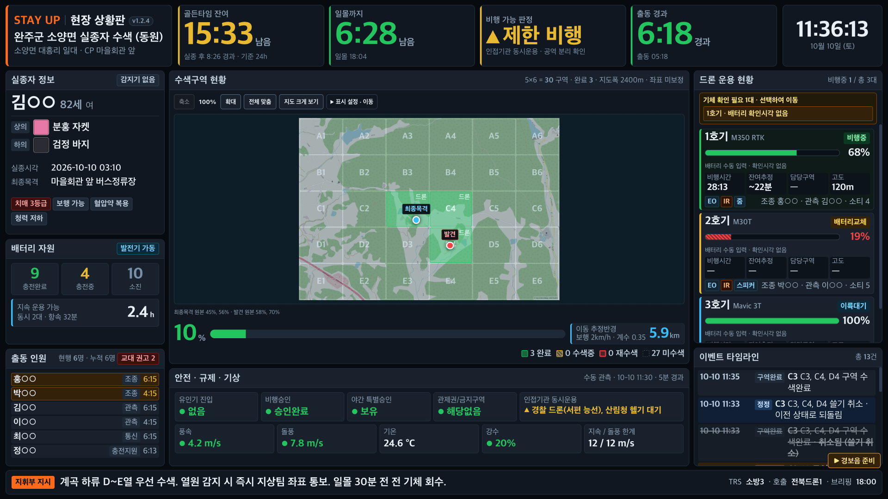
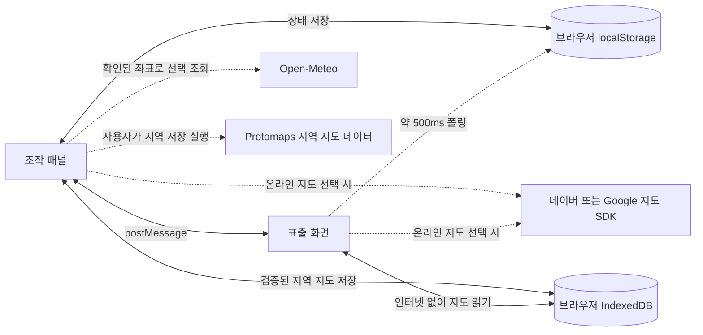
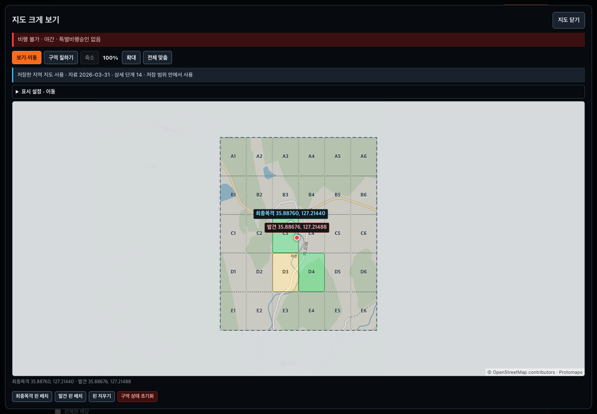
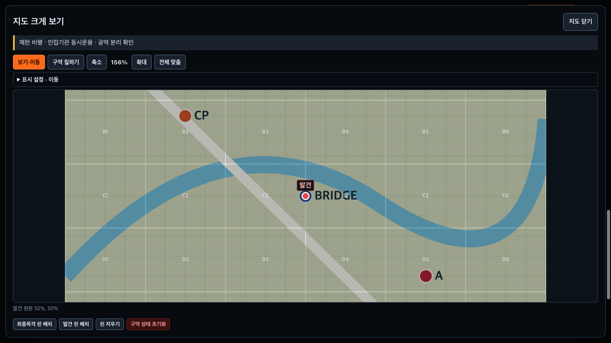
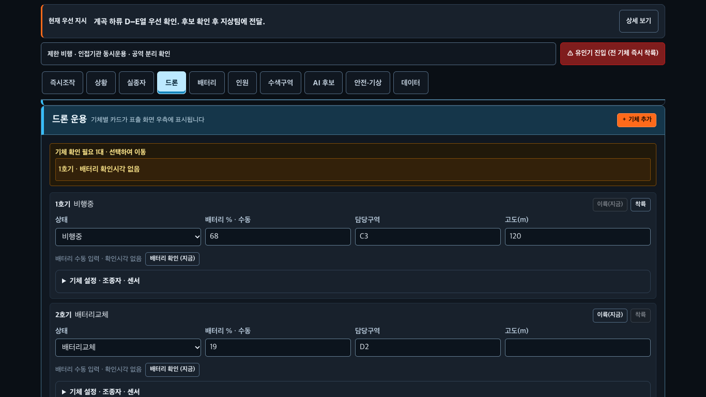

<!-- markdownlint-disable MD013 MD033 -->

# STAY UP 현장 상황판

<p align="center">
  <strong>실종자 수색 현장의 드론·인원·수색구역·안전정보를 한 화면에 모으는 오프라인 우선 상황판</strong>
</p>

<p align="center">
  
  
  
  
  
</p>

<p align="center">
  <a href="https://github.com/MuyeongKim/stayup-dash/archive/refs/heads/main.zip"><strong>Download ZIP</strong></a>
  ·
  <a href="#빠른-시작">빠른 시작</a>
  ·
  <a href="./USER_GUIDE.md"><strong>사용설명서</strong></a>
  ·
  <a href="#현재-검증-상태">검증 상태</a>
</p>

<p align="center">
  
</p>

<p align="center"><sub>사용자 가이드 대표 이미지 · 실제 운영 화면이나 자동 비행 기능을 나타내는 그림이 아닙니다.</sub></p>

STAY UP은 현장 조작자가 입력한 내용을 같은 PC의 대형 모니터에 즉시 반영하는 오프라인 우선 대시보드입니다. 사진 지도는 HTML을 직접 열어 사용하고, 지역 지도는 필요한 수색 범위를 미리 저장해 인터넷 없이 확대·이동하며 사용합니다. 지역 지도의 표시 도구는 배포 폴더에 함께 들어 있어 실행 중 CDN에 의존하지 않습니다. 선택적인 자동 기상 조회와 네이버·구글 온라인 지도는 인터넷을 사용하며, 온라인 지도를 선택한 경우에만 해당 사업자의 지도 SDK를 불러옵니다.

조작 패널은 상단 메뉴에서 **선택한 입력 영역 하나만** 표시합니다. 선택 메뉴는 밝은 배경과 하단선으로, 해당 입력 영역은 같은 파란 계열의 제목 띠로 구분합니다. 탭 전환은 입력 영역을 숨기거나 보여주며 상황 데이터와 작성 중 내용을 유지합니다. 유인기 경보·현재 우선 지시·안전 판정은 모든 메뉴의 공통 영역에 남고, 좁은 화면에서도 상단 메뉴를 좌우로 밀거나 기존 하단 메뉴로 이동할 수 있습니다.

> [!CAUTION]
> **현재 버전은 훈련·시연 및 개발 검증용이며, 실출동 단독 운용 승인 전입니다.** 2026-08-23 Chrome 실행 감사에서 확인된 차단 항목 7건은 모두 해소했습니다(아래 [현재 검증 상태](#현재-검증-상태)). 다만 확인은 개발 환경(localhost, Chromium)에서만 이뤄졌으며, 대상 PC·브라우저·스피커·듀얼 모니터에서 인수시험을 마치기 전에는 현장 지휘나 비행 판단의 단일 근거로 사용하지 마십시오.

## 처음 사용한다면

**[사용설명서 읽기](./USER_GUIDE.md)**에서 실행 → 상황 준비 → 조작·기록 → 백업·종료 순서로 따라 하세요.

- [PDF 사용설명서](./docs/STAY-UP-사용설명서.pdf): 인쇄하거나 다른 사람에게 전달할 때 사용합니다.
- [HTML 사용설명서](./docs/user-guide.html): ZIP을 푼 뒤 `docs/user-guide.html`을 브라우저로 엽니다. 본문과 그림은 인터넷 없이 읽을 수 있습니다.
- [조작 패널](./assets/readme/console-preview.png) · [원거리 표출 화면](./assets/readme/far-preview.png): 지도 미적용 상태의 이전 검토용 샘플입니다.
- [실제 지도 기본 표출](./assets/readme/dashboard-preview.png) · [큰 지도 구역 칠하기](./assets/readme/map-workspace-preview.png) · [확대·이동](./assets/readme/map-zoom-pan-preview.png) · [전체 맞춤과 핀](./assets/readme/map-pins-preview.png): 실제 완주군 지도 위에 가상 상황을 표시한 PC 예시입니다. 지도 © OpenStreetMap 기여자 · [저작권 및 ODbL 안내](https://www.openstreetmap.org/copyright).
- [저장 지역 지도 실행 화면](./assets/readme/offline-map-preview.png): 2026-10-18 실제 앱에서 네트워크를 차단한 뒤 다시 연 예시입니다. 원본 지도 자료는 2026-03-31 기준이며 핀·구역은 가상 데이터입니다. 지도 © OpenStreetMap 기여자 · Protomaps.
- [대표 썸네일 PNG](./assets/readme/stayup-thumbnail.png) · [제작 프롬프트](./assets/readme/thumbnail-prompt.md)



*2026-10-10, v1.2.4 PC 기본 표출(1920×1080). 지도는 실제 지형이며 실종자·기체·인원·핀·기록은 가상 시연 데이터입니다. 실제 현장 사례가 아니며 지리좌표 보정도 하지 않았습니다. 지도폭·추정반경·배터리·기상·판정은 샘플 입력과 계산 결과로 실측·실시간 정보가 아닙니다. 지도 © OpenStreetMap 기여자 · [저작권 및 ODbL 안내](https://www.openstreetmap.org/copyright).*

## 무엇을 한 화면에 모으나

- **상황 개요** — 출동시각, CP, 좌표, TRS 채널, 호출부호, 지휘부 지시
- **실종자 정보** — 인상착의, 최종목격, 특이사항, 이동 추정반경
- **드론 운용** — 기체 상태, 배터리, 담당구역, 고도, 조종·관측, 소티
- **수색구역** — 최대 12×12 격자, 상태·담당, 사진·저장한 지역 지도·네이버·구글 배경, 최종목격·발견 핀, 좌표 범위 설정 후 칸별 위경도
- **안전·기상** — 승인, 야간, 유인기 경보, 풍속·돌풍·강수, 일출·일몰
- **활동기록** — 발생시각 기반 타임라인, 정정·취소, JSON 백업, 활동일지 복사
- **AI 사진 후보** — AI-page의 사진 후보 파일 추가·갱신, 축소 이미지·판정·촬영 위치, 대응 상태·메모와 별도 타임라인

상단 KPI는 실종 후 경과, 일몰, 입력된 안전조건에 따른 비행 판정, 출동 경과를 보여줍니다. 배터리 지속시간과 이동 반경은 입력값을 이용한 **계획 보조용 근사치**이며 실제 텔레메트리나 GIS 분석이 아닙니다.

## 작동 구조



- 조작 패널과 표출 화면은 **동일 PC·동일 브라우저 저장영역**을 사용합니다.
- 창이 직접 연결돼 있으면 `postMessage`, 연결이 끊기면 `localStorage` 폴링으로 상태를 따라갑니다.
- 서버, 로그인, 클라우드 동기화, 기관 간 네트워크 공유는 제공하지 않습니다.
- AI-page와는 `stayup-ai-candidates.json` 파일로 연결합니다. 같은 PC에서는 양쪽의 **자동 저장/자동 읽기 폴더 연결**로 작업별 후보 파일을 약 2초 간격으로 갱신할 수 있습니다. 같은 PC나 다른 PC에서 **AI 후보 불러오기** 또는 후보 JSON 한 개를 끌어다 놓아 추가/갱신합니다. 기존 **JSON 불러오기**는 상황 전체 복원용입니다. 반복 파일·과거/충돌 갱신을 구분하고 기존 상황·대응 기록을 보존합니다. [공통 형식·검증 기록](./docs/ai-photo-bridge.md)을 참고하세요.
- 후보는 사진 촬영 GPS이며 고유 인원이나 사람의 정확한 좌표가 아닙니다. GPS 없음·지도 미보정·지도 범위 밖은 목록으로 유지합니다. 원본 판정과 상황판의 대응 상태·메모를 분리하고, 원본에서 빠진 후보도 대응 이력을 보존합니다. 연계 버전으로 조작·표출 창을 모두 다시 여세요.
- 자동 기상을 켜면 위·경도가 Open-Meteo 요청에 포함됩니다.
- 온라인 지도를 켜면 해당 지도 사업자의 SDK와 지도 데이터를 요청합니다. 지도 조회 위치·접속 정보·인증키 등이 사업자에게 전달되므로, 외부 연결을 사용할 수 있는 환경에서 선택합니다. 상황 기록을 서버에 공유하는 기능은 아닙니다.
- 지역 지도 저장은 Protomaps의 공개 지도 자료에서 선택한 수색 범위와 세부 수준에 필요한 데이터를 내려받습니다. 네이버·구글 타일을 복사하지 않으며, 핀·구역 상태·상황 기록을 지도 제공자에게 전송하지 않습니다. 준비가 끝난 지역 지도는 IndexedDB에서 읽고, 앱 파일은 서비스 워커가 준비한 캐시에서 읽습니다.

> [!NOTE]
> **사진·저장한 지역 지도·온라인 지도를 선택할 수 있습니다.** 사진은 파일 직접 실행으로 사용합니다. 지역 지도 저장과 앱의 오프라인 재시작은 HTTPS 또는 `localhost`·`127.0.0.1`에서 준비합니다. 네이버·구글은 별도의 키와 등록된 웹 주소가 필요합니다. 지도 파일은 상황 JSON과 별도로 내보내며, 네이버·구글 타일은 저장하지 않습니다.

## 빠른 시작

### 비개발자

1. [ZIP 파일](https://github.com/MuyeongKim/stayup-dash/archive/refs/heads/main.zip)을 내려받아 압축을 풉니다.
2. `stayup-dash.html`을 **Chrome 또는 Edge**로 엽니다.
3. 새 브라우저 프로필에서 기능을 볼 때만 `샘플 상황 넣기`를 사용합니다.
4. `표출 화면 열기`를 누르고 새 창을 대형 화면으로 옮깁니다.
5. 표출 창의 `🔊 경보음 준비`를 눌러 시험음과 출력 장치를 확인합니다.

사진 지도는 파일을 직접 열어 사용할 수 있습니다. 지역 지도 저장과 온라인 지도는 **압축을 푼 폴더 전체**를 [로컬 웹 실행](#개발자-메모)하거나 HTTPS로 배포해 사용합니다. 지역 지도에는 네이버·구글 인증키가 필요하지 않습니다. [미리 저장 절차](#필요한-지역-지도를-미리-저장하기)를 따르고, 네이버·구글은 [온라인 지도 연결](#네이버구글-온라인-지도-연결)을 설정하세요. `file://`에서 웹 주소로 옮기기 전에는 JSON을 내보내 새 주소에서 불러와야 기존 기록을 이어갈 수 있습니다.

> 운영 데이터가 이미 있다면 샘플을 넣기 전에 반드시 JSON을 내보내십시오. `샘플 상황 넣기`·`전체 초기화`·`직전 작업 복구`는 복구점을 먼저 만들며, 복구점 저장에 실패하면 덮어쓰지 않고 중단합니다.

### Git으로 받기

```bash
git clone https://github.com/MuyeongKim/stayup-dash.git
cd stayup-dash
```

macOS에서는 다음처럼 Chrome으로 직접 열 수 있습니다.

```bash
open -a "Google Chrome" stayup-dash.html
```

## 기본 운용 흐름

1. 상단의 `편집권 보유`, 저장 상태, 표출 연결 상태를 확인합니다.
2. 상황명·수색 장소·출동시각과 위·경도를 입력하고 `현장 좌표 확인 완료`를 누릅니다.
3. 실종자, 기체, 배터리, 인원, 수색격자를 입력합니다. **성명 칸에는 실명을 넣지 않습니다**(`대상` 또는 이니셜 — 아래 [저장·백업·개인정보](#저장백업개인정보) 참조).
4. 승인상태와 현장 기상 관측시각·풍속·돌풍·강수를 확인합니다.
5. 기체 전용 버튼과 격자 셀로 실제 상태를 변경하고 이벤트를 기록합니다.
6. 종료 전 JSON을 내보내 실제 파일 생성 여부를 확인하고 활동일지를 복사합니다.
7. 공용 PC에서는 개인정보 완전삭제 후 **열린 관련 창을 모두 닫고**, 다운로드·USB·스크린샷·클립보드 사본도 별도로 정리합니다.

노트북 1대에 표출 화면을 대형 모니터로 내보내는 구성에서는, 기록자가 노트북 화면(조작 패널)만 보게 됩니다. 그래서 **조작 패널 상단 바에도 핵심 KPI 네 개를 둡니다** — `골든 15:39 남음 · 일몰 1:17 남음 · 판정 ▲제한 비행 · 출동 6:12 경과`. 표출 화면과 같은 계산을 공유하므로 두 화면의 숫자가 어긋날 수 없습니다.

조작 패널은 **즉시조작 → 드론 → 배터리 → 수색구역 → 안전·기상** 순서로 자주 쓰는 항목을 먼저 보여줍니다. 상황·실종자·인원·데이터 관리와 기체 제원·좌표 보정은 접어 두고 필요할 때 펼칩니다. 상단 섹션 칩을 누르면 접힌 항목도 자동으로 열리고 해당 제목으로 이동합니다. 열어 둔 설정은 입력·저장 후에도 유지되며, 읽기 전용 상태에서도 이동과 펼치기가 가능합니다.

배터리 잔량은 실제 텔레메트리가 아닌 **수동 입력**입니다. 값을 입력하거나 기체의 `배터리 확인 (지금)`을 누르면 확인시각을 기록하며, 조작 패널과 표출 화면에서 경과시간을 함께 보여줍니다. 구버전 데이터처럼 확인시각이 없으면 이를 그대로 표시합니다.

비행·통신불량 상태인 기체는 **위험 요약**에서도 확인할 수 있습니다. 통신불량과 배터리 20% 미만은 위험, 20~30% 미만은 주의로 표시합니다. 배터리 값·확인시각이 없거나 마지막 확인 후 5분 이상 지났을 때도 재확인을 안내합니다. 이 5분은 수동 입력의 신선도 안내 기준이며 기체의 운용 한계나 자동 비행 판정 기준이 아닙니다. 요약을 누르면 해당 기체로 이동하고, 카드의 등록 순서는 유지됩니다.

상단 판정 안내를 펼치면 전체 사유와 해당 입력으로 이동하는 버튼이 나옵니다. 휴대 화면에서는 짧은 판정 상태줄과 하단 `조작 / 지도 / 기체 / 더보기` 메뉴가 남습니다. 입력 오류는 필드 아래에서 확인하고 수정할 수 있습니다.

수색 중 지도는 기본 `보기·이동`으로 확인합니다. 구역을 바꿀 때만 `구역 칠하기`를 선택하고 팔레트에서 상태·담당을 고릅니다. 작업을 마치면 `보기·이동`으로 돌아갑니다. 자세한 내용은 [수색격자와 지도](#수색격자와-지도)를 참고하십시오.

빠른기록으로 남긴 `이륙·착륙·구역완료·인원교대`는 **타임라인에만** 들어갑니다. 기체·격자·인원의 실제 상태와 어긋나면 `즉시 조작` 구역에 불일치 목록이 뜨고, 버튼 한 번으로 상태를 기록에 맞출 수 있습니다. 자동으로 바꾸지 않는 이유는 오기록이 곧바로 표출 화면에 퍼지는 것을 막기 위해서입니다. 반영할 때는 원래 기록을 중복 생성하지 않고 `정정` 이력만 남깁니다.

`이륙·착륙` 기록은 대상 기체를, `인원교대` 기록은 대상 인원을 선택한 뒤 `이력만 기록`을 누릅니다. 발생시각의 기본값은 제출 순간인 `지금`이며, 사후 기록에는 `과거 시각 지정`을 선택합니다. 최근 3건 밖의 기록은 `전체 기록 조회 · 정정 · 취소`를 펼쳐 찾습니다. 검색어는 내용·구역·날짜를 대상으로 하며 유형과 취소 여부도 함께 필터링할 수 있습니다.

### 기본·원거리 표출

`데이터 → 표출 구성`에서 `기본 · 전체 정보` 또는 `원거리 · 핵심 정보`를 선택합니다. 원거리는 비행 판정을 앞에 크게 배치하고 기체 모델·센서·소티·인원 명부 등의 상세를 줄여 지도와 위험 요약을 확보합니다. 원본 정보는 조작 패널에 그대로 남습니다. 원거리의 핵심 글자 크기는 전체 배율과 별도로 유지해 확대 시 다시 작아지지 않습니다.

`상황 → 현재 우선 지시`에는 지금 실행할 지시를 **80자 이내**로 입력합니다. 원거리 화면은 이를 고정 표시하며, 긴 원문은 `지휘부 지시 전문`에 남깁니다. 우선 지시가 비어 있으면 80자 이내의 전문을 표시하고, 전문이 더 길면 우선 지시 입력 안내를 표시합니다. 구성과 우선 지시는 저장·백업·두 창 동기화에 포함됩니다.

[원거리 표출 예시 보기](./assets/readme/far-preview.png) — 1920×1080, 앱 배율 150%, 검토용 샘플 데이터입니다.

화면이 하나뿐이면 표출 화면에서 `Ctrl+E`로 조작 드로어를 열 수 있습니다. 다른 조작 창이 편집권을 보유하면 드로어는 읽기 전용입니다.

## 비행 판정 규칙

| 표시 | 조건 예시 |
| --- | --- |
| `판정 보류` | 좌표 미입력·미확인, 승인 미확인·미신청·신청중, 기상 미확정·필수값 누락, 기상 관측 또는 현장 확인 후 30분 경과, 태양시각 계산 불가 |
| `제한 비행` | 풍속·돌풍이 각 한계의 80% 이상, 강수확률 60% 이상, 승인된 야간, 일몰 30분 전, 인접기관 동시운용 |
| `비행 불가` | 유인기 진입, 관제권·비행금지구역 승인 미완료, 한계 이상 풍속·돌풍, 현재 강수, 야간승인 없는 야간, 비행 중 기체의 조종자 교대 종료 |
| `비행 가능` | 위 보류·주의·불가 조건이 없을 때 |

판정과 안전 항목은 **색과 형태를 함께** 씁니다. 색을 구분하기 어렵거나 프로젝터 색 재현이 나빠도 등급이 읽힙니다.

| 표식 | 뜻 |
| --- | --- |
| ● | 가능 · 정상 |
| ▲ | 제한 · 주의 |
| ■ | 불가 · 위험 |
| ○ | 보류 · 미확인 |

> [!IMPORTANT]
> 화면의 판정은 입력값을 계산한 보조 표시입니다. 드론을 제어하거나 공역·NOTAM·유인기를 자동 감지하지 않으며, 현장 지휘·관계 법령·실제 승인·제작사 제한·현장 계측을 대체하지 않습니다.

`동시 운용 인접기관`을 입력하면 중앙 판정이 `제한 비행`으로 내려가 공역 분리 확인을 요구합니다. 비행 중인 기체의 조종자가 인원 명부에서 교대 종료 상태이면 `비행 불가`로 표시합니다.

> [!NOTE]
> 조종자 연결은 **기체의 `조종(정)`과 인원 명부의 성명·식별명이 정확히 일치할 때만** 성립합니다. 비행중·통신불량 기체의 조종자가 공란·미등록이거나, 역할이 `조종`이 아니거나, 투입시각이 없거나, 교대 종료 상태이면 `비행 불가`로 표시합니다. 인원 등록과 기체 입력에 동일한 고유 별칭을 사용하고, 투입시각 및 종료시각 공란을 확인하세요. 같은 별칭이 여러 사람을 가리키지 않도록 구분하십시오.

### 유인기·발견 경보

- `⚠ 유인기 진입`은 화면을 적색으로 바꾸고 비행 불가와 즉시 착륙 지시 문구를 표시하지만, 실제 기체 상태나 비행을 제어하지 않습니다.
- 일반 기록 한도에 도달해도 유인기 경보와 긴급 이력을 계속 기록합니다. 다만 브라우저 저장공간이 고갈되면 저장·전달 자체는 실패할 수 있으며, 이 경우 별도 실패 안내를 확인하고 현장 연락수단을 사용해야 합니다.
- `발견` 이벤트는 표출 화면에 배너를 띄우고 준비된 Web Audio 경보음을 재생합니다.
- 브라우저 자동재생 정책 때문에 표출 창을 열 때마다 사용자가 `경보음 준비`를 눌러야 합니다.

## 수색격자와 지도

배경 지도를 준비한 뒤 **보기 → 확대·이동 → 필요한 위치 기록** 순으로 사용합니다. 사진은 빈 지도 영역의 `지도·현장 사진 넣기`, 설정 안의 `이미지 파일 선택…`, 드래그앤드롭 또는 클립보드 붙여넣기로 넣습니다. 인터넷이 없는 현장을 준비한다면 아래의 지역 지도 저장을 먼저 완료하세요.

### 필요한 지역 지도를 미리 저장하기

저장 지도는 **Protomaps·OpenStreetMap 기반의 도로·건물·수계 지도**입니다. 데이터에 있는 지명·도로명 등 일부 이름을 로컬 글꼴로 표시하며, 위성사진은 포함하지 않습니다. 네이버·구글과 배경 모양·표시 정보는 다르지만, 같은 수색 좌표 범위를 사용하므로 핀과 칠한 구역의 위치는 유지됩니다. 사진 한 장을 저장하는 방식과 달리 여러 세부 수준의 지도를 저장합니다. 지도 자료는 [Protomaps 공개 다운로드](https://docs.protomaps.com/basemaps/downloads)의 [Source Cooperative 배포본](https://source.coop/protomaps/openstreetmap)을 사용합니다.



*2026-10-18, 실제 앱의 저장 지역 지도 화면(1440×1000). 네트워크 차단 후 다시 열어 가상 핀과 C3·D4 완료 구역 유지를 확인했습니다. 원본 자료는 2026-03-31 기준이며 다운로드·촬영 날짜와 다릅니다. 실제 출동 사례나 물리 GPS 정확도 검증 결과가 아닙니다. 지도 © OpenStreetMap 기여자 · Protomaps · [저작권 및 ODbL 안내](https://www.openstreetmap.org/copyright).*

1. **같은 주소·브라우저에서 준비합니다.** 인터넷이 연결된 상태에서 HTTPS 또는 `localhost`·`127.0.0.1`로 앱을 엽니다. HTML만 복사하지 말고 함께 제공되는 폴더 전체를 사용하세요. 앱의 오프라인 재시작에는 서비스 워커가 필요하므로 `file://` 또는 일반 HTTP의 다른 PC 주소에서는 준비할 수 없습니다.
2. **수색 범위를 정합니다.** 기존 사진의 좌표 보정을 마쳤거나 네이버·구글 수색 범위가 있다면 그대로 사용합니다. 사진 없이 처음 시작할 때는 `배경 지도 → 저장한 지역 지도`를 선택하고 `새 수색 범위 만들기`에서 중심 위·경도와 가로폭을 지정합니다. **새 수색 범위를 만드는 동작은 기존 구역·담당·핀을 초기화**하므로, 이미 작업 중인 범위에서는 다시 만들지 마세요.
3. **`수색구역 → 지도·격자 설정`을 펼쳐 `오프라인 지역 지도`를 찾습니다.** `저장 세부 수준`에서 `넓은 지역`(12), `기본`(14), `상세`(15) 중 하나를 고릅니다. 높은 값은 더 자세하지만 다운로드량과 저장공간이 늘어납니다. 저장 범위는 현재 수색 범위이며, 확대 화면의 일부만 저장하는 것은 아닙니다.
4. **`이 수색 범위 미리 저장`을 누릅니다.** 표시되는 예상 타일 수와 한도를 확인하고 진행률이 끝날 때까지 기다립니다. 취소하거나 다운로드·저장에 실패하면 준비 완료로 표시하지 않으며, 이전에 저장한 지도와 현재 핀·구역 기록을 유지합니다. 앱 파일도 함께 준비합니다. 지도 준비와 앱 준비 상태가 모두 완료됐는지 확인하세요. 앱 업데이트 대기 안내가 나오면 관련 창을 모두 닫고 같은 주소를 다시 엽니다.
5. **`저장 지도 사용`으로 확인합니다.** 저장 지도 목록에서 이번 범위의 지도를 선택합니다. 배경만 바뀌며 핀·칠한 구역·담당·활동기록은 그대로 남습니다. 알려진 도로·건물과 핀·격자가 맞는지 조작 창과 표출 창에서 확인합니다.
6. **출발 전에 실제로 연결을 끊어 봅니다.** 인터넷을 끈 뒤 확대·이동과 핀·구역 위치를 확인하고, 같은 주소에서 새로고침해 지도와 작업 내용이 다시 나오는지 확인합니다. 앱 파일을 따로 준비하려면 `앱 오프라인 준비`를 사용합니다. 로컬 서버로 여는 경우 서버 프로세스와 같은 주소·포트를 유지하세요. 평소 네이버·구글을 사용하려면 점검 후 인터넷을 연결하고 해당 `배경 지도`를 다시 적용합니다. 저장 지도 연결은 유지됩니다.

**통신이 끊겼을 때:** 사용 중인 수색 범위를 덮는 저장 지도가 선택돼 있으면 네이버·구글 연결 끊김 또는 SDK 오류 시 해당 지도로 전환합니다. 저장 지도에서 계속 핀 배치·구역 칠하기·기록을 할 수 있습니다. 인터넷이 돌아와도 편집 중 배경이 갑자기 바뀌지 않도록 저장 지도를 유지합니다. `온라인 지도 다시 연결`을 눌러 복귀하세요. 맞는 저장 지도가 없거나 저장 데이터를 읽을 수 없으면 지형이 준비된 것으로 표시하지 않고 안내와 편집 보호를 적용합니다.

**저장 범위와 세부 수준:** 저장 범위 밖의 지형은 준비되지 않았다는 안내를 확인하세요. 저장한 최고 세부 수준보다 더 확대하면 기존 지도가 커질 뿐 새로운 세부 정보가 생기지 않습니다. 저장 지도는 최대 12개, 지도 하나당 4,096개 타일·100MiB까지이며 가져올 지도 파일은 145MiB 이하입니다. 실제 저장 가능량은 브라우저의 남은 공간에 따라 줄어듭니다. 내려받은 날짜가 원본 지도의 갱신 날짜는 아니며, 저장 후 현장 변화가 자동 반영되지 않습니다.

**지도도 별도로 백업합니다.** `지도 파일 내보내기`로 지역 지도 파일을 보관하고, 다른 브라우저에서는 상황 JSON을 불러온 뒤 `지도 파일 가져오기`로 지도를 가져와 사용합니다. 새 환경에서는 `앱 오프라인 준비`도 완료하세요. 상황 JSON에는 지역 지도 참조와 수색 기록이 들어가지만 큰 지도 데이터 본체는 들어가지 않습니다. `선택 지도 삭제`는 확인 후 해당 저장 지도를 지우며, 핀·구역·활동기록을 지우는 기능은 아닙니다. 현재 상황에 연결된 지도는 삭제를 차단하므로 다른 저장 지도를 연결하거나 새 상황으로 전환한 뒤 삭제합니다. 브라우저 데이터 삭제·저장공간 회수에 대비해 JSON과 지도 파일을 함께 보관하세요.

지역 지도 내보내기 파일은 `.stayup-map.json`으로 끝납니다. 상황의 `JSON 불러오기`와 구분해 `지도 파일 가져오기`로 엽니다.

### 네이버·구글 온라인 지도 연결

1. 앱을 HTTPS 주소 또는 로컬 HTTP에서 엽니다. 로컬 실행은 [개발자 메모](#개발자-메모)의 명령을 사용합니다. `file://` 직접 실행에서는 앱이 온라인 지도 연결을 차단하고 웹 주소로 여는 방법을 안내합니다.
2. `수색구역 → 지도·격자 설정 → 온라인 지도 연결 설정`을 펼칩니다. 네이버는 Maps Application에서 **Web Dynamic Map**과 실행할 웹 주소를 등록하고 Client ID를 준비합니다. 구글은 결제 계정이 연결된 프로젝트에서 **Maps JavaScript API**를 켜고 API 키에 웹사이트와 API 제한을 설정합니다. [네이버 Application 안내](https://guide.ncloud-docs.com/docs/maps-app), [Google API 설정](https://developers.google.com/maps/documentation/javascript/get-api-key), [Google 키 제한 안내](https://developers.google.com/maps/api-security-best-practices)를 참고하세요.
3. 사용할 사업자의 `NAVER Client ID (ncpKeyId)` 또는 `Google Maps API 키`를 입력하고 `이 브라우저에 키 저장`을 누릅니다. 네이버 Client Secret을 넣는 칸이 아닙니다. 키는 현재 주소·브라우저의 별도 설정에 저장하며 상황 JSON·복구본·활동일지에 포함하지 않습니다. 입력값을 가려도 브라우저용 키가 비밀 저장소에 보관되는 것은 아니므로 사업자 콘솔의 도메인·API 제한을 적용하세요. 삭제는 `저장한 키 삭제`를 사용합니다.
4. `배경 지도`에서 `네이버지도` 또는 `구글지도`, `지도 종류`에서 `일반지도` 또는 `위성지도`를 고릅니다. **기존 사진에 좌표 보정이 돼 있다면** 같은 범위로 `배경 적용`을 누릅니다. 보정이 없다면 사진을 먼저 [2점 보정](#좌표-보정)하거나, 중심 위·경도와 가로폭을 입력해 `새 수색 범위 만들기`를 펼쳐 `이 좌표로 새 수색 범위 만들기`를 누릅니다. 가로폭은 **0.1~100km**이며 정북 기준의 직사각형 범위를 만듭니다. 새 범위 생성은 확인과 복구본 저장을 거쳐 기존 구역 상태·담당, 기체 담당구역, 핀, 사진과 기존 보정을 초기화하므로 먼저 JSON을 보관하세요.
5. 지도가 표시되면 알려진 지점·핀·격자가 맞는지 조작 창과 표출 창에서 대조합니다. 지도 종류를 바꿀 때는 선택한 뒤 `배경 적용`을 누릅니다. 온라인 배경을 적용할 수 없다는 안내가 나오면 웹 주소·키·좌표 범위를 확인하세요. 새 범위도 웹 실행 환경·키·인터넷이 준비되지 않으면 기존 자료를 초기화하지 않고 중단합니다.

확대·이동은 기존 보기 도구를 사용합니다. **지도를 이동해도 수색 범위와 칸의 위·경도는 이동하지 않습니다.** 격자·핀·추정반경은 지도 SDK의 좌표 변환으로 배경 위에 다시 배치합니다. 핀의 점·설명 글자와 격자 글자는 읽기 편한 크기를 유지합니다. `구역 칠하기`, 핀 배치, `직전 쓸기 취소`는 같은 방식으로 사용하며, 정해진 수색 범위 밖에는 기록하지 않습니다.

**사업자나 지도 종류만 바꾸는 것은 새 수색 범위를 만드는 작업과 다릅니다.** 같은 좌표 범위의 사진↔저장 지도↔네이버↔구글 전환은 구역·핀을 유지하고, 기존 보정 사진도 남깁니다. 인터넷·인증 오류가 나면 범위가 맞는 저장 지도로 전환합니다. 사용할 저장 지도가 없으면 실패 안내와 지도 편집 보호를 적용합니다. `사진·오프라인`을 선택해 `배경 적용`하면 기록을 유지한 채 저장된 사진으로 돌아갑니다. 보관된 사진이 없으면 격자만 보이므로 지형이 복구된 것으로 판단하지 마세요.

네이버·구글 지도 타일은 JSON이나 오프라인 캐시에 보관하지 않습니다. 인터넷이 없는 현장을 위해서는 위 절차로 별도의 지역 지도를 저장하거나 사용 권한이 있는 지도 이미지와 좌표 범위를 준비하세요. 새 브라우저에서 온라인 지도를 쓰려면 키를 다시 설정해야 하며 사업자 요금·이용량·도메인 인증은 해당 계정 설정을 따릅니다. 문서의 그림은 기존 사진 모드와 저장 지역 지도 예시이며 네이버·구글 실접속 화면은 아닙니다.

### 지도 보기와 표시 설정



*큰 지도에서 C3·C4·D4를 완료·담당 드론으로 칠한 PC 예시입니다. 실제 완주군 지도 위의 구역·핀·상황은 가상이며 실제 수색 실적이 아닙니다. 지리좌표 보정과 실거리 검증은 하지 않았습니다. 지도 © OpenStreetMap 기여자 · [저작권 및 ODbL 안내](https://www.openstreetmap.org/copyright).*

[전체 맞춤과 핀](./assets/readme/map-pins-preview.png), [약 244% 확대·이동](./assets/readme/map-zoom-pan-preview.png) 사진은 같은 원본 지도에서 보기 상태만 달라진 예시입니다. 지도 © OpenStreetMap 기여자 · [저작권 및 ODbL 안내](https://www.openstreetmap.org/copyright). 지도 출처·촬영 조건은 [지도 이미지 출처](./assets/readme/MAP_SOURCE.md)에 기록했습니다.

**모바일 핀 표시 보완:** 지도와 큰 지도의 핀 라벨은 최소 13px, 점은 최소 14px로 표시하며 기본·큰 글자 표시 모두 하한을 유지합니다. 점 테두리는 최소 2px, 라벨 여백은 상하 최소 2px·좌우 최소 5px로 맞췄습니다. 표시 CSS만 보완했으며 핀의 저장 위치와 좌표 계산은 바꾸지 않았습니다. 실제 PC·휴대 장비의 화면 배율, 시청거리와 물리 터치는 별도 인수시험 대상입니다.

위 사진은 v1.2.4 촬영본입니다. 당시 390px 화면에서 기록한 라벨 약 2.93px·점 약 3.41px는 **개선 전 수치**이며 현재 표시 크기를 뜻하지 않습니다.

- **기본은 `보기·이동`입니다.** 지형을 살펴보려고 누르거나 끌어도 구역·핀·활동기록을 바꾸지 않습니다.
- 사진 모드에서는 `확대`·`축소`로 1~16배 범위에서 세부를 보고 확대된 사진을 마우스·손가락으로 끌어서 이동합니다. `전체 맞춤`으로 사진 전체가 보이는 상태로 돌아옵니다. 온라인 지도에서는 같은 도구로 지도 배율·중심을 바꾸고 `전체 맞춤`으로 수색 범위를 봅니다. 구역·핀·이동 추정반경은 같은 지형을 가리키며, 핀 아이콘·설명과 격자 글자의 화면 크기는 유지합니다.
- **`지도 크게 보기`**로 사진 중심의 넓은 작업 공간을 엽니다. 세로 사진이나 파노라마의 작은 지점을 확인할 때 사용합니다. `지도 닫기`로 돌아옵니다. `Esc`는 진행 중인 핀·기준점 배치를 먼저 취소하고, 배치 중이 아니면 큰 지도를 닫습니다. 표출·읽기 전용 창에서도 보기 도구를 사용할 수 있습니다. 큰 지도에서 입력칸 밖의 `+`·`-`는 지도만 확대·축소합니다.
- 큰 지도에도 유인기·미확인 발견 경보와 저장·복구 실패 안내가 나타납니다. `지도 닫고 전체 상태 확인`은 큰 지도를 닫는 버튼이며, 경보 확인이나 문제 해결을 대신하지 않습니다.
- `표시 설정 · 이동`에서 방향 버튼으로 이동하거나, `격자`·`담당`·`추정반경` 표시와 `격자 채움 농도` 값을 조절합니다. 표시를 숨겨도 구역·핀 등 원본 기록은 삭제하지 않습니다.
- 확대·이동·표시 설정은 **현재 창에서만 사용하는 보기 상태**입니다. 다른 표출 창으로 자동 전파하거나 JSON 기록에 저장하지 않습니다. 각 화면에서 필요한 배율과 표시를 선택합니다. 설정 안의 `사진 불투명도`는 사진 자체의 밝기를 조절하는 기존 저장 항목입니다.
- 핀·격자는 **고정된 수색 범위 안의 상대 위치**로 저장합니다. 사진 모드에서는 원본 이미지가 기준이며, 온라인 모드에서는 보정·생성한 위·경도 범위로 변환해 표시합니다. 좌표 보정 후에도 보기 배율을 바꿀 수 있으며, 지도틀의 모양이나 배율이 달라도 같은 칸의 지형·좌표는 바뀌지 않습니다.

### 구역 칠하기와 핀 배치

`구역 칠하기`를 선택하고 지도 위의 팔레트에서 칠할 것을 먼저 고릅니다. 휴대 화면에서는 `칠하기 설정`을 펼쳐 선택하고 다시 접어 지도 공간을 확보합니다. 접힌 제목에도 현재 상태·담당 선택값을 표시합니다. 작업 후에는 `보기·이동`으로 돌아갑니다.

```text
상태   [그대로] [미수색] [수색중] [완료] [재수색]
담당   [그대로] [없음] [드론] [지상] [수색견] [소방대]
```

- 마우스·손가락으로 칸을 누르거나 여러 칸을 쓸어 반영합니다. 터치 칠하기에서는 칸 크기가 충분하도록 자동 확대될 수 있습니다. 페이지 스크롤은 `보기·이동`과 `전체 맞춤` 상태에서 합니다. `구역 칠하기`의 손가락 쓸기는 기록 변경입니다.
- 고른 항목만 바뀝니다. `그대로`를 고르면 그 항목은 건드리지 않으므로, 상태를 유지한 채 담당만 바꿀 수 있습니다.
- 한 번의 칠하기 작업은 타임라인에 **한 줄**로 기록됩니다. 이미 완료였던 칸은 다시 칠해도 기록이 늘지 않습니다. 브라우저가 취소한 포인터 동작과 두 손가락이 닿아 중단된 칠하기는 저장하지 않습니다.
- 칠한 뒤 빠른기록의 `구역`이 비어 있으면 방금 칠한 첫 칸이 자동으로 채워집니다.
- **직전 쓸기 한 번은 되돌릴 수 있습니다.** 팔레트 아래 `직전 쓸기 취소` 또는 `Ctrl+Z`. 칸을 쓸기 전 값으로 복원하고, 그 쓸기가 남긴 `구역완료` 기록은 지우지 않고 무효 처리하며 정정 이력을 남깁니다. 다른 상황을 불러오거나 상대 창의 상태를 받으면 되돌리기 기록은 버려집니다.
- `최종목격 핀 배치`·`발견 핀 배치`를 선택한 뒤 **사진 내부 또는 온라인 지도의 수색 범위 내부**를 누릅니다. 사진 밖 여백이나 온라인 수색 범위 밖은 위치로 받지 않습니다. 가장자리 핀의 설명은 지도 영역 안쪽에 배치합니다. 배치 중단은 `배치 취소` 또는 `Esc`를 사용합니다.
- 키보드는 칸에 포커스를 두고 방향키로 이동한 뒤 `Enter`·`Space`로 선택 동작을 실행합니다. `보기·이동`에서는 구역을 칠하지 않습니다. 핀·좌표 기준점 배치 모드에서는 선택 칸의 중심에 배치하며 구역 상태를 칠하지 않습니다. 정밀한 위치는 마우스·터치로 지정합니다.
- 네 상태는 색과 **채움 무늬**로 함께 구분합니다. `미수색`은 점선 테두리에 빈 칸, `수색중`은 사선, `완료`는 진한 채움, `재수색`은 이중 테두리입니다.

`지도·격자 설정`을 펼쳐 행·열을 입력한 뒤 `격자 크기 적용`을 누릅니다. 변경 전 확인과 복구본 저장을 거치며, 구역 상태·담당과 기체 담당구역은 초기화됩니다. 지도·핀·좌표 보정은 유지합니다. **다른 지도 이미지로 교체할 때는 핀·좌표 보정도 초기화**되므로 다시 지정해야 합니다. 변경 전 상태는 데이터 메뉴에서 복구할 수 있습니다.

### 이미지 보관과 구버전 자료

- 이미지는 최대 가로 **3,072px**로 축소하고 JPEG 품질 0.82로 저장합니다. JSON 백업에는 앱에서 사용하는 축소 이미지가 포함되므로, 고해상도 원본과 좌표 파일도 별도로 보관하세요. HEIC은 브라우저에서 열리지 않을 수 있습니다.
- IndexedDB를 쓸 수 없는 환경에서는 종전과 같이 **1,600px·3 MiB**로 되돌아가고, 조작 패널에 그 사실을 표시합니다.
- 구버전의 이미지에만 적용되던 확대·이동값은 해제하고 전체 사진을 기준으로 표시합니다. 이전 확대·이동 또는 좌표 보정 이력이 있는 자료는 재확인 대상입니다. **재확인 안내가 나오면 JSON 원본을 보관한 뒤 핀·구역·좌표 보정을 알려진 지점과 대조하세요.** 새 칠하기·핀 배치는 `지도·표식 확인 완료` 전까지 잠깁니다. 보정 오류는 먼저 다시 보정할 수 있으며, 확인은 복구본 저장과 확인창을 거칩니다. 잘못된 기존 핀은 확인 후 다시 지정하세요. 이미 잘못 기록된 위치·보정값은 자동으로 복원하지 않습니다.
- 이동 추정반경은 입력한 거리·보행속도·시간을 이용하는 근사 표시입니다. 지형·도로·장애물에 따른 실제 이동 가능 영역을 계산하지 않습니다.

### 좌표 보정

사진의 보정 전 격자는 **픽셀 좌표계**입니다. 무전으로 구역 이름은 부를 수 있지만 지상팀 GPS에 찍을 위경도는 나오지 않습니다. 보정하면 **모든 칸과 핀에 좌표가 생깁니다.** 온라인용 새 수색 범위를 만들었다면 입력한 중심·폭으로 좌표 범위가 이미 설정되므로 사진의 2점 보정을 다시 할 필요가 없습니다. 두 경우 모두 입력값이 실제 위치와 맞는지 알려진 지점으로 대조해야 합니다.

**방법 1 — 수동 2점.** 지도에서 **대각선으로 떨어진 두 점**을 찍고 각각의 위경도를 입력합니다. 같은 행이나 같은 열에 있으면 축척이 나오지 않아 거부합니다. 카카오맵·네이버지도는 지도에서 우클릭하면 위경도를 보여줍니다.

**방법 2 — 좌표 파일.** 정사영상은 이미지와 좌표 파일을 **같이 끌어다 놓으면 자동으로 적용**됩니다.

| 형식 | 지원 |
| --- | --- |
| `.jgw` / `.tfw` / `.pgw` / `.wld` (world file) | 지원. 숫자 6줄. WGS84 경위도만 |
| `.kml` GroundOverlay | 지원. `LatLonBox`를 읽습니다 |
| 미터 좌표계 (UTM·TM·EPSG:5186 등) | **미지원.** 투영 역변환이 필요합니다. 매핑 소프트웨어에서 WGS84 경위도로 내보내거나 2점 보정을 쓰세요 |
| 회전이 포함된 파일 | **미지원.** 정북 정렬로 다시 내보내세요 |
| GeoTIFF | **미지원.** 브라우저가 디코딩하지 못합니다 |

> [!IMPORTANT]
> 잘못된 좌표를 지상팀에 넘기는 것보다 거부하는 편이 안전하므로, 판정이 어려운 입력은 받지 않습니다. 지도 범위가 비정상적으로 넓거나 좁으면, 남북이 뒤집혀 있으면, 위경도 범위를 벗어나면 적용을 거부하고 이유를 표시합니다.

보정 후에는:

- 칸 좌표를 빠른기록 `구역`칸 옆에서 바로 읽을 수 있습니다 (`C3 중심 35.89000, 127.21583`)
- 표출 화면의 최종목격·발견 핀 라벨에 위경도가 붙습니다
- `지도 가로 실거리`가 손입력이 아니라 **보정값으로 계산한 거리**로 대체됩니다. 이동 추정반경은 여전히 지형을 반영하지 않는 근사치입니다
- 활동일지에 지도 범위와 보정 방식이 기록됩니다
- 다른 이미지로 바꾸면 크기가 같더라도 구역·핀과 함께 보정이 해제됩니다. 같은 이미지의 재적용은 유지합니다

| 환경 | 클립보드 캡처 |
| --- | --- |
| macOS | `⌘ + Control + Shift + 4` 후 `⌘V` |
| Windows | `Win + Shift + S` 후 `Ctrl+V` |

macOS의 `⌘ + Shift + 4`는 기본적으로 파일을 저장합니다. 이 경우 저장된 이미지를 끌어다 놓거나 `이미지 파일 선택…`을 사용합니다.

## 기상과 일출·일몰

- 일출·일몰은 확인된 좌표로 브라우저에서 계산합니다. 좌표가 없을 때 다른 지역을 대신 사용하지 않습니다.
- 자동 기상은 확인된 좌표와 인터넷이 있을 때 10분마다 Open-Meteo 모델값을 조회합니다.
- 자동값도 `현장 기상 확인 완료` 전에는 비행 판정에 사용하지 않습니다.
- 한 번 확인한 뒤에는 **자동 갱신이 들어와도 판정이 바뀔 만한 변화가 없으면 확인 상태를 유지합니다.** 다음 중 하나라도 해당하면 확인이 풀리고 다시 눌러야 합니다.
  - 강수 여부가 바뀜
  - 풍속 또는 돌풍이 1 m/s 이상 변동
  - 풍속·돌풍이 설정한 한계의 80% 또는 100% 구간을 새로 넘거나 벗어남
  - 강수확률이 60% 경계를 넘거나 내려감
  - 수동 관측값이 자동 모델값으로 교체됨
- 관측시각이 30분에 도달하거나, **확인한 지 30분이 지나면** 기상은 만료되고 판정을 보류합니다.
- 수동 기상을 입력하면 자동 덮어쓰기를 중지하며, 진행 중이던 늦은 자동응답도 수동값을 덮어쓰지 않습니다.
- Open-Meteo 값은 현장 풍속계나 공식 관측·승인을 대신하지 않습니다.

## 저장·백업·개인정보

| 항목 | 동작과 한계 |
| --- | --- |
| 브라우저 저장 | 현재 브라우저 프로필의 `localStorage`에 평문 저장 |
| 자동 복구 | 변경 상태를 30초 주기로 최대 5개 보조 복구본에 저장. 데이터 화면에서 작업 직전 복구점과 자동 복구본을 시각·사유별로 선택. 서로 다른 5개 시점을 보장하지 않음. 저장공간이 부족하면 오래된 세대부터 버려 최소 1개는 남기며, 세대가 줄면 화면에 경고 |
| **자동 보관** | 켜두면 변경분을 지정한 파일에 덮어씁니다. 파일을 지정하지 않았거나 지정이 불가능하면 변경분이 있을 때 약 10분 간격으로 JSON을 내려받습니다. 첫 보관은 더 일찍 시작될 수 있으며, 편집권을 가진 창만 보관합니다 |
| 지도 이미지 | **IndexedDB**에 별도 보관(수백 MB 가용). 막힌 환경에서는 `localStorage`로 내려가며 한도도 종전 값으로 복귀 |
| 저장한 지역 지도 | **IndexedDB**에 지도 데이터·범위·세부 수준을 보관. 저장 완료 전 검증하며 사진의 `localStorage` 폴백과는 별개. 지도 파일로 별도 내보내기·가져오기 |
| 앱 오프라인 준비 | 서비스 워커가 앱과 함께 제공되는 지도 표시 파일을 캐시. HTTPS·localhost 환경에서 같은 주소의 오프라인 재시작에 사용 |
| JSON 내보내기 | 상태·이벤트·저장된 사진 이미지·배경 선택·좌표 범위·지역 지도 참조 포함. 지역 지도 데이터 본체와 온라인 지도 인증키·타일은 제외. 다른 위치에 보관할 수 있는 상황 백업 수단 |
| 온라인 지도 키 | 현재 웹 주소·브라우저의 별도 로컬 설정. 상황 JSON·복구본·활동일지에서 제외. `저장한 키 삭제`로 제거 |
| JSON 불러오기 | 지원 버전·필수 구조·지도 data URL 외형을 검사. 실제 손상 이미지 디코딩까지 보장하지 않음 |
| 활동일지 복사 | 상황·기체·수색·인원·이벤트·안전정보를 텍스트로 정리해 클립보드에 복사 |
| 완전삭제 | 브라우저의 `stayup.dash.*` 데이터·온라인 지도 키 설정·IndexedDB 사진 및 지역 지도 제거. 다운로드·USB·스크린샷·클립보드 사본은 제거하지 않음 |

활동 타임라인은 그대로 보고서가 됩니다. 브라우저 저장소만 믿으면 프로필 초기화·브라우저 변경·파일 경로 이동 한 번에 출동 기록이 사라지고, 자동 복구본도 같은 저장소라 함께 없어집니다. 그래서 **자동 보관을 기본으로 켜 둡니다.**

- `화면 설정 · 데이터`에서 `보관 파일 지정…`을 누르고 파일을 하나 정하면, 이후 변경은 그 파일에 조용히 덮어씁니다. 창을 새로고침하면 다시 지정해야 합니다.
- 출동 종료 또는 성공한 초기화·불러오기·복구·샘플 전환 뒤에는 보관 파일 연결이 해제됩니다. 다음 출동용 파일을 다시 지정하세요. 지정 전에는 다운로드 방식으로 보관합니다.
- 파일을 지정하지 않았거나 지정이 지원되지 않는 환경에서는 변경분이 있을 때 약 10분 간격으로 JSON을 내려받습니다. 다운로드 폴더에 파일이 쌓이므로 종료 후 승인된 위치로 옮기고 정리하십시오.
- 상단 바의 `보관 N분 전` 표시로 실제로 보관되고 있는지 확인할 수 있습니다.
- 자동 보관과 수동 `JSON 내보내기`는 **저장된 사진 지도 본체도 포함**합니다. 지역 지도는 참조만 포함하므로 `지도 파일 내보내기`도 필요합니다. 온라인 지도는 배경 선택·좌표 범위만 포함하며 사업자의 타일·인증키는 포함하지 않습니다. 큰 사진을 쓰면 파일 기록 시간이 늘 수 있으므로 상단의 보관 상태를 확인하십시오.

> [!IMPORTANT]
> **실종자 성명은 실명 대신 `대상` 또는 이니셜을 사용하십시오.** 실종자 성명은 표출용이며 비행 판정에 사용하지 않습니다. 실명을 넣으면 로그인·암호화·감사로그가 없는 브라우저 저장소와 다운로드·자동 보관 파일에 평문으로 남습니다. 좌표·인상착의·특이사항도 개인을 식별할 수 있으므로 기관의 처리·보관 기준에 따라 필요한 정보만 입력하세요. **인원 명부와 기체의 `조종(정)`에는 서로 정확히 일치하는 고유 별칭**을 사용합니다. 이 별칭은 현행 조종자 투입 상태를 확인하는 데 사용됩니다.

<!-- markdownlint-disable-next-line MD028 -->
> [!WARNING]
> 로그인, 암호화, 권한 분리, 서버 백업, 변조방지 감사로그는 없습니다. 파일명·경로 변경, 브라우저 변경, `file://`과 로컬 HTTP 전환은 저장영역을 바꿀 수 있으므로 먼저 JSON을 내보내십시오. 완전삭제 후에는 이전 상태 메시지 재유입을 막기 위해 관련 창을 모두 닫으십시오. 삭제 도중 창을 닫아 편집 잠금 안내가 계속 나오면 브라우저의 해당 사이트 데이터를 지운 뒤 다시 여십시오.

## 현재 검증 상태

이전 v1.2.1의 Chrome 실행 감사에서 확인한 기본 동작은 다음과 같습니다. 최신 작업본의 재검증 결과와 범위는 아래 `이번 업데이트`에 별도로 적었습니다.

- 초기 공란의 `판정 보류`, 야간·일몰 경계, 승인 상태, 풍속·돌풍 한계, 기상 30분 만료
- 지연된 자동응답의 수동 기상 보호와 실제 Open-Meteo 응답 파싱
- JSON 구조·버전 거부, 낮은 revision 가져오기 승격, 지도 저장 실패 롤백
- 발견 배너·경보음 준비·확인 동기화, 키보드 격자 조작
- 1,440×900·1,600×900 표출과 390px 조작 화면의 수평 오버플로 없음
- Google Chrome 151에서 `file://` 직접 부팅

### 이번 업데이트

2026-10-25 조작 패널의 메뉴와 입력 내용이 같은 어두운 색으로 이어져 구분하기 어렵다는 사용 의견을 반영했습니다.

- **메뉴별 입력 탭** — 선택한 입력 영역 하나만 표시하며 처음에는 `즉시조작`을 엽니다. 선택 메뉴의 밝은 배경·하단선과 입력 영역의 파란 제목 띠를 연결했습니다.
- **입력 내용 보존** — 탭 전환은 기존 입력 영역의 표시만 바꿉니다. 기존 상황·기체·인원·수색구역·AI 후보·대응 기록과 작성 중 빠른기록·대응 메모를 유지하며, 메뉴 선택 자체는 저장 리비전이나 사건 기록을 바꾸지 않습니다.
- **공통 경보·작은 화면·키보드** — 유인기 경보·현재 우선 지시·안전 판정은 모든 메뉴에 남습니다. 상단 메뉴 고정, 좁은 화면의 가로 이동·선택 메뉴 노출, 기존 하단 메뉴와 방향키·Enter·Space 조작을 지원합니다.
- **사용설명서** — Markdown·오프라인 HTML·PDF에 메뉴 선택 방법과 새 조작 화면을 반영했습니다.



*2026-10-25, 1366×768 조작 패널 검증 화면입니다. 기체·잔량·구역·지시는 가상 데이터이며 실제 출동 실적이 아닙니다.*

검증: 전체 브라우저 회귀 **411/411**, 실제 Chrome 화면·데이터 보존·키보드·입력 탭 검사 **85/85**, 지역 지도 엔진 **18/18**, 오프라인 재시작 **11/11**을 통과했습니다. 변경 전 프로그램에서 저장한 가상 상황·지도·핀·기체·인원·후보·기록을 변경 후에도 복원하고, 백업 내보내기·다시 열기와 두 화면 동기화를 확인했습니다. 화면 검사는 PC 및 모바일 크기의 Chrome에서 수행했습니다.

### 이전 업데이트 (v1.2.13)

2026-10-19 승인된 OpenDesign 보완 시안의 배치와 우선 지시 접근성을 운영판에 반영했습니다. 낮은 노트북 화면은 표출의 지도·지시를 한 화면에 배치하고, 좌우 상세는 내부 스크롤로 유지합니다. 모바일은 우선 지시를 첫 화면과 스크롤 중에 표시하고 조작 화면의 안전 판정도 함께 유지합니다. **상세 보기**에서 지휘부 지시 전문·연락 정보를 확인하며, 키보드 건너뛰기와 44px 상세 버튼을 제공합니다.

기존 우선 지시·전문 필드와 저장·지도·기체·활동·AI 후보·대응 기록, 수동 불러오기와 자동 폴더 연계를 유지합니다. 저장 정책·데이터 형식·외부 연결은 추가하지 않았습니다. [사용 방법](./USER_GUIDE.md) · [반영 결정과 검증 방법](./docs/layout-accessibility.md).

검증: 기존 전체 회귀 **399/399**와 추가 실제 Chrome 화면·저장 보존 검사 **69/69**를 통과했습니다. 구버전에서 저장한 가상 상황·격자·핀·기체·인원·후보 이미지·대응·이벤트가 앱 버전 표기 외에는 그대로 유지됨을 확인했습니다. 1920×1080·1440×900·1366×768·1280×720 기본/원거리, 1366×768 글자 1.5배, 390×844·360×800 조작/표출, 높이 640px의 스크롤 대체 경로를 검사했습니다. 실제 OS 폴더 연계는 HTTP·file:// 각각 11/11, 오프라인 브라우저 재시작 11/11, 온라인 SDK·지역 지도 엔진 각각 18/18을 통과했습니다. Markdown·HTML·PDF 사용설명서도 갱신했습니다. 모바일은 Chrome의 화면 크기로 검증했으며 물리 휴대폰·현장 장비 인수시험을 뜻하지 않습니다.

### 이전 업데이트 (v1.2.12)

2026-10-18 같은 PC의 사진 후보 폴더 자동 연계를 추가했습니다. **AI 후보 → 자동 읽기 폴더 연결**에서 AI-page의 자동 저장 폴더를 선택·확인하면 기존 상황·대응 기록을 유지하며 추가/갱신합니다. 수동 불러오기도 유지합니다. 연결은 현재 창·상황에만 유효하며 새로고침·상황 교체·수동 가져오기·권한/편집권 상실 후 다시 선택합니다. 파일 삭제는 기존 기록을 삭제하지 않습니다. 자세한 제한·오류 처리·검증은 [연계 문서](docs/ai-photo-bridge.md)를 참고하세요.

검증: 전체 브라우저 **399/399 통과**(기존 375 + 폴더 24), 실제 OS 디렉터리 핸들 검사 로컬 HTTP·file:// 각각 11/11 통과, 온라인 SDK 18·지역 지도 엔진 18·오프라인 재시작 11개 통과. 실제 macOS 탐지 GUI와 Chrome을 동시에 실행해 같은 폴더로 후보 9개를 자동 반영하고 판정 리비전 1→2 및 대응 메모 보존을 확인했습니다. OS 폴더 선택창·Windows EXE·물리 캡처보드·기관망 인수시험은 별도입니다.

### 이전 업데이트 (v1.2.10–v1.2.11)

2026-10-18 수색 범위의 지역 지도를 미리 저장하고 통신이 끊긴 뒤 이어 쓰는 기능을 추가했습니다.

- **수색 범위 미리 저장** — Protomaps·OpenStreetMap 기반 지도를 범위·세부 수준에 맞춰 저장합니다. 진행률·취소·완료 검증을 제공하며 실패한 저장으로 기존 지도를 바꾸지 않습니다. 네이버·구글 타일을 저장하는 기능은 아닙니다.
- **핀·구역을 유지한 배경 전환** — 같은 수색 범위를 덮는 저장 지도가 있으면 통신 끊김·온라인 SDK 실패 시 저장 지도로 전환합니다. 저장 지도에서도 핀·구역·담당·기록을 유지해 작업하고, 통신 복귀 후에는 사용자가 온라인 재연결을 선택합니다.
- **앱 재시작과 별도 지도 백업** — 함께 제공되는 지도 표시 도구와 서비스 워커로 오프라인 재시작을 준비합니다. 상황 JSON과 지역 지도 파일을 별도로 내보내고 가져옵니다. 배포 폴더 전체, 같은 웹 주소·브라우저 프로필, 저장공간이 필요합니다.
- **사용 안내** — README와 Markdown·HTML·PDF 사용설명서에 출발 전 저장·연결 끊기 확인, 범위·세부 수준 한계, 온라인 복귀와 백업 절차를 추가했습니다.
- **최종 검증** — AI 후보 연계의 최신 수정까지 포함한 브라우저 회귀 **375/375 통과**(기존 350 + 오프라인 전환 25). 온라인 SDK 계약 18건, 지역 지도 엔진 18건, 실제 브라우저 종료·서버 종료 후 오프라인 재시작 11건도 통과했습니다. 실제 완주군 자료 19타일·1,946,021바이트로 저장 후 인터넷을 차단하고 핀 배치·구역 칠하기·재열기 보존을 확인했습니다. 390px 화면 가로 넘침 없이 표시됐습니다. 네이버·구글 실키 연결과 물리 현장 GPS 정확도는 이 검증 범위가 아닙니다.

### 이전 업데이트 (v1.2.8–v1.2.9)

- **사진 후보 연계 1단계(2026-10-18)** — AI-page V26.1018에서 내보낸 파일을 현재 상황에 추가·갱신합니다. 작업/후보 ID·리비전으로 중복·과거·충돌을 구분하며 기존 상황·지도·수색 상태·대응 기록을 유지합니다. AI 후보의 대응 상태·메모와 원본 판정을 분리하고 원본에서 빠진 후보도 보존합니다. 작은 이미지는 별도 블롭 저장소와 전체 JSON 백업·복구·삭제에 포함합니다.
- **연계 검증** — 브라우저 **350/350 통과**(기존 315 + 연계 35), 기존 온라인 SDK 계약 검사 18개 통과. 실제 YOLO에서 내보낸 9개 후보 파일로 두 창 동기화·기존 상황 보존·리비전 갱신·대응 보존을 확인했고, 새 브라우저 저장소로 별도 PC 구성을 재현해 파일만으로 미리보기 9장을 읽었습니다. 물리적인 다른 PC·기관망·실제 지도 사업자 키 연결은 별도 인수시험입니다.

### 이전 업데이트 (v1.2.7)

2026-10-18 선택형 네이버·구글 배경 지도를 추가했습니다.

- **사진·온라인 배경 선택** — 기존 오프라인 사진 지도에 네이버·구글의 일반·위성 지도를 선택적으로 연결합니다. HTTPS·로컬 HTTP와 사업자 인증 설정이 필요하며, `file://`에서는 사진 모드를 사용합니다.
- **같은 위치의 구역·핀 유지** — 좌표 보정된 사진의 범위를 그대로 사용하거나, 중심·가로폭으로 새 수색 범위를 만듭니다. 배경만 바꿀 때 기록을 유지하며, 새 범위 생성은 확인·복구본을 거쳐 구역·핀·사진·기존 보정을 초기화합니다. 확대·이동 중 수색 범위는 고정하고 지도 투영에 맞춰 격자·핀·반경을 표시합니다.
- **키·연결 실패 처리** — 키는 별도 브라우저 설정으로 저장하고 JSON·복구본에서 제외합니다. 지도 로딩·인증 실패 때 편집을 막고 사진 배경으로 돌아갈 수 있도록 안내합니다. 온라인 타일의 저장·내보내기는 제공하지 않습니다.
- **검증** — 온라인 지도 검사 50건을 포함한 브라우저 회귀 **315/315 통과**, 별도 SDK 로더·인증·비동기 범위 맞춤 계약 검사 **18/18 통과**. 두 공급자는 모의 SDK로 검증했으며 실제 키·도메인 인증·지도 타일 표시는 아직 검증하지 않았습니다. 연결 설정은 PC·390px 화면에서 가로 넘침 없이 확인했고 사용설명서 HTML·PDF도 갱신했습니다.
- **사용 안내와 검증 범위** — README와 사용설명서에 연결·범위 설정·확대·칠하기·복귀 절차를 추가했습니다. 유효한 실서비스 키를 사용한 네이버·구글 실제 접속과 과금·도메인 인증은 확인하지 않았습니다. SDK 계약 모형을 이용한 검사는 실제 지도 표시 성공을 뜻하지 않습니다.

2026-10-10 모바일 지도 핀의 표시 크기를 추가 보완했습니다.

- **작은 화면에서도 핀 크기 하한 유지** — 라벨 글자 최소 13px, 점 최소 14px, 테두리 최소 2px, 라벨 여백 상하 최소 2px·좌우 최소 5px를 적용했습니다. 기본·큰 글자 표시 모두 하한을 유지하면서 넓은 화면에서는 기존 상대 크기로 커집니다.
- **위치 데이터 유지** — 표시 CSS만 수정했으며 JavaScript의 핀 배치·좌표 계산·저장 로직은 변경하지 않았습니다.
- **촬영본과 현재 안내 구분** — 사용설명서의 PC 사진은 v1.2.4 촬영본으로 유지하고, 당시 모바일 핀 크기 문제를 개선 전 기록으로 구분했습니다. 실제 지도 출처·가상 상황·좌표 미보정 안내는 유지합니다.
- **회귀 검증** — 모바일 핀 검사 16건을 포함해 **265/265 통과**했습니다. 같은 검사를 수정 전 CSS로 실행하면 크기 검사 4건이 실패해 261/265였고, 수정 후 320px·390px 폭의 조작 패널과 큰 지도 모두 라벨 13.00px·점 14.00px를 확인했습니다. 원본 이미지 좌표의 핀 중심 유지, 상태 JSON·revision 불변, 네 모서리의 긴 좌표 라벨 표시도 통과했습니다. 이는 Chromium의 화면 크기 설정을 이용한 검증이며 실제 휴대폰·물리 터치 장비 인수시험을 대신하지 않습니다.

추가 브라우저 확인에서는 320/375/390/430/768px 모두 라벨 13px·점 14px 하한과 가로 넘침 없음을 확인했습니다. 390px 터치 에뮬레이션의 큰 지도에서 약 244% 확대 후 (-40, -25px) 이동해도 두 핀 중심의 원본 좌표와 상황 JSON이 유지됐습니다. 1920×1080 표출의 기본·150% 큰 글자 표시도 기존 상대 크기를 유지하며, 작은 화면의 큰 글자 모드에서도 하한이 적용됩니다.

앞선 2026-10-10 문서 갱신에서는 화면 예시를 실제 OpenStreetMap 완주군 지도 촬영본으로 바꿨습니다. 실종자·기체·인원·핀·기록은 가상이며 실제 현장 사용 실적이 아닙니다. Markdown·오프라인 HTML·PDF에 같은 사진과 인접 출처 캡션을 반영했고, 지리좌표 미보정·샘플 수치·촬영 당시 모바일 핀 가독성 제약을 명시했습니다. 해당 문서 갱신만 수행한 단계에서는 앱 동작 로직을 수정하거나 전체 앱 회귀검사를 다시 실행하지 않았습니다. 버전 번호는 기존 GitHub 자동 증가 정책에 따라 푸시 후 갱신됩니다.

2026-10-10 메인 지도 사용성과 위치 기록 보호를 보완했습니다. 앱 버전은 기존 GitHub 자동 버전 정책에 따라 릴리스 시 갱신합니다.

- **확대해도 같은 위치** — 사진·격자·핀·추정반경을 같은 이미지 좌표계로 확대·이동합니다. 좌표 보정 후에도 세부 지형을 볼 수 있으며, 보기 배율을 바꿔도 저장된 위치나 위경도는 달라지지 않습니다.
- **보기와 기록 구분** — 기본 `보기·이동`에서 지도를 살펴보고, `구역 칠하기` 또는 핀 도구를 고른 경우에만 기록을 바꿉니다. 취소된 포인터 동작은 저장하지 않습니다.
- **사진 내부에 핀 배치** — 사진 밖 여백을 위치로 받지 않으며, 가장자리 핀 설명을 안쪽으로 배치합니다.
- **큰 지도와 표시 설정** — `지도 크게 보기`, 확대·축소·전체 맞춤, 격자·담당·추정반경 전환과 격자 채움 농도 조절을 제공합니다. 보기 설정은 창마다 독립적이며 현장 기록을 바꾸지 않습니다. 모바일 칠하기 설정을 접어 지도 공간을 확보하고, 큰 지도 안에도 긴급 경보·저장 실패를 표시합니다.
- **구버전 자료 보호** — 이전의 이미지 전용 확대·이동값을 해제하고 관련 자료의 위치 재확인을 안내합니다. `지도·표식 확인 완료`까지 새 칠하기·핀 배치를 잠그고 확인 전 복구본을 남깁니다. 기존 핀·구역·보정값을 추측으로 이동하거나 삭제하지 않습니다.
- **사용 안내** — README와 사용설명서의 지도 절차를 실제 도구 순서에 맞게 개정하고, 원본 이미지 보관과 구버전 자료 확인 방법을 추가했습니다.
- **검증** — 기존 206건과 신규 지도 검사 43건, **249/249 브라우저 회귀검사 통과**. 확대·이동 및 보정 후 위치 일관성, 읽기 전용 보기, 핀 경계, 구버전 자료 재확인, 큰 지도 경보·저장 실패·포커스를 검사했습니다. 별도 Chromium 터치 에뮬레이션에서는 390×844·12×12 격자의 보기 스크롤 시 기록 변경 없음, 칠하기 취소 시 미저장, 정상 손떼기 시 완료 기록 1건을 확인했습니다. 360×800 큰 지도 칠하기 화면은 가로 넘침 없이 지도 영역 338×348px을 확보했습니다. 실제 Escape 입력으로 핀 취소 → 큰 지도 닫기 → 열기 버튼 포커스 복귀도 확인했습니다. 1920×1080·150%·유인기 경보 표출에서는 지도 높이 254px을 확보하며, 안전 카드의 긴 내용은 내부 스크롤로 확인합니다. 물리 터치기기·스피커, `file://` 직접 실행, 실제 시청거리와 절전 복귀는 별도 인수시험 대상입니다.

### 이전 업데이트 (v1.2.3)

2026-09-22 UI/UX 검토 후 수정보완 작업입니다.

- **초보자용 사용설명서·썸네일** — 실제 버튼과 동작을 대조한 8장 사용설명서를 Markdown·HTML·PDF로 제공합니다. HTML은 그림을 포함해 오프라인으로 읽을 수 있습니다. 대표 썸네일과 기본·원거리 화면 예시를 함께 제공합니다. 기존 조종자 등록·판정 안내도 현재 동작에 맞게 바로잡았습니다.

- **정확한 조작 대상 유지** — 반복 카드의 버튼을 누른 뒤 같은 기체·인원의 포커스를 유지합니다. 대상 삭제 시 목록 제목, 버튼이 비활성화되면 같은 카드로 이동해 다음 키 입력이 다른 대상에 적용되지 않게 했습니다.
- **일관된 지도 작업** — 포인터·키보드가 같은 핀 배치 동작을 사용합니다. 현재 배치 모드와 취소 버튼을 표시하고 Escape로 취소합니다.
- **위험 기체 상시 요약** — 스크롤되는 카드 목록 위에 저배터리·통신불량·미확인 또는 오래된 수동 확인값을 표시합니다. 위험을 먼저 정렬하며 요약에서 해당 카드로 이동할 수 있습니다. 많은 기체가 동시에 해당되면 요약 영역도 스크롤됩니다.
- **판정에서 다음 행동으로 연결** — 조작 패널에 핵심 사유를 직접 보여 주고 전체 확인 항목과 입력 위치 이동 버튼을 제공합니다.
- **빠른 기록 정리** — 유형·대상·구역·발생시각을 묶고 내용 입력 옆에 `이력만 기록`을 배치했습니다. 실제 기체·인원·구역 상태와 이력의 차이를 입력 전에 안내합니다.
- **원거리·모바일 구성** — 원거리 프리셋과 고정 우선 지시, 모바일의 짧은 판정 상태줄과 하단 탐색을 추가했습니다. 저장된 상세정보는 유지합니다.
- **입력 오류 복구** — 필드별 설명과 보조기기 오류 정보를 제공합니다. 잘못된 초안은 현재 화면에 보존하되 새 상황으로 전환하거나 정상 교대 종료·기상 갱신으로 실제 값이 바뀌면 폐기합니다.
- **검증** — 기존 176건과 신규 30건, **206/206 브라우저 회귀검사 통과**. 실제 2호기 반복 조작·키보드 핀 배치, 1366×768 조작 패널, 390×844 터치 에뮬레이션, 1920×1080 기본·원거리 표출을 확인했습니다. 원거리 판정 글자는 약 70px이며 150%에서도 유지됩니다. 실제 시청거리에서의 판독성, 물리 키보드·터치기기·스피커, `file://` 직접 실행과 절전 복귀는 이번 검사 범위에 포함되지 않습니다.

### 이전 업데이트 (v1.2.2)

2026-09-05 코드리뷰 후 수정보완 작업입니다.

- **두 화면의 비행 판정 일치** — 지운 풍속·돌풍 한계를 동기화·재시작 과정에서 임의의 12m/s로 바꾸지 않습니다. 입력·저장·표출·활동일지 모두 미설정을 유지하며, 유효한 0.5m/s 입력도 같은 값으로 보존합니다.
- **지도·격자 변경 보호** — 다른 지도 교체 전 확인과 복구본을 거쳐 구역 상태·담당, 기체 담당구역, 핀, 좌표 보정을 초기화합니다. 격자 행·열은 초안 입력 후 `격자 크기 적용`으로 확정하며, 취소하거나 복구본 저장이 실패하면 기존 상태를 유지합니다. 격자 크기만 바꿀 때 지도·핀·좌표 보정은 유지합니다. 변경 전 구역 기록은 이전 격자의 이력으로 남고 새 격자를 완료로 되돌리지 않습니다.
- **지도 원본 보존** — localStorage 지도를 IndexedDB로 옮길 때 실제 쓰기와 재조회 성공을 확인한 경우에만 원본을 삭제합니다. 이관 실패 시에는 기존 지도 사본을 남깁니다.
- **출동별 보관 파일 분리** — 출동 종료와 성공한 초기화·불러오기·복구·샘플 전환에서 기존 보관 파일 연결을 해제합니다. 늦게 끝난 파일 선택·쓰기 작업이 다음 출동을 이전 파일에 덮지 않도록 보호합니다. 취소·저장 실패 시 기존 연결은 유지합니다.
- **기록 대상 정확성** — 이륙·착륙·인원교대 빠른 기록에서 대상을 선택합니다. 새 기록은 기체·인원 ID로 연결하고, 기존 문구형 기록은 대상 이름이 명확히 하나만 일치할 때만 연결합니다. `11호기`를 `1호기`로 오인하거나 정상적인 구역 완료 취소를 다시 불일치로 안내하던 문제를 수정했습니다.
- **전체 기록 조회·정정** — 최근 3건을 바로 표시하고, 전체 이력은 펼쳐서 내용·구역·날짜 검색, 유형·취소 여부 필터, 20건 단위 페이지 이동으로 찾습니다. 오래된 기록도 정정·취소할 수 있습니다. 정정은 문구 변경이며, 시각·구역·대상을 바꿀 때는 기존 기록을 취소하고 다시 기록합니다.
- **긴급 경보와 기록 한도 분리** — 일반 기록 5,000건 이후에도 유인기 경보와 긴급 이력을 기록합니다. 긴급 기록 100건부터 보관 안내를 표시하며, 그 이후도 임의로 잘라 버리지 않습니다. 실제 저장공간 부족으로 경보 저장·전달에 실패하면 별도로 알립니다.
- **운영 중심 화면·확대 가독성** — 자주 쓰는 조작을 앞으로 모으고 설정은 펼쳐서 사용합니다. 라벨·안내문을 키우고, 확대 시 카드 폭에 맞게 핵심 숫자와 기체 정보의 배치를 조정했습니다. 인원·타임라인이 화면 아래로 밀려나지 않도록 각 카드 영역을 제한하고 수색지도 공간을 확보했습니다.
- **수동 배터리 확인시각** — 기체마다 잔량 확인시각을 저장하고 두 화면에서 경과시간을 갱신합니다. 활동일지에도 수동 입력임을 표시하며 오래된 확인시각을 새 입력처럼 표시하지 않습니다.
- **검증 결과** — 기존 130건에 신규 46건을 추가한 브라우저 회귀검사 **176/176 통과**. 실제 두 창에서 풍속 한계를 지운 뒤 모두 `판정 보류`가 되는지 확인했습니다. 1920×1080·150%·유인기 경보 상태에서 지도 영역 1072×242px, KPI와 카드 경계 및 기체 수치의 가림 방지를 검사했습니다. 확대·경보 상태에서는 카드 내부의 긴 정보에 세로 스크롤이 필요할 수 있습니다.

추가 화면 확인: 1366×768 조작 패널에서 샘플·기본 접기 상태의 문서 높이는 약 5,226px에서 3,507px로 줄었습니다. 390px 터치 환경 에뮬레이션에서도 가로 넘침 없이 샘플을 입력했습니다. 이번 작업의 자동화 도구는 `file://` 탐색을 지원하지 않아 직접 파일 실행은 재검증하지 않았습니다. 이는 앱의 실행 실패를 확인한 결과가 아니며, 물리 스피커·듀얼 모니터·절전 복귀와 함께 대상 장비에서 확인해야 합니다.

### 이전 업데이트 (v1.2.1)

- **전광판 가독성** — 긴 지휘부 지시, 여러 기체의 비행 제한 사유, 인접기관 장문 입력을 제한된 영역에 요약해 수색지도가 밀려나지 않도록 했습니다. 전체 내용은 접근 가능한 설명으로 유지합니다.
- **모바일·접근성** — 터치 환경의 격자·버튼·범위·색상 입력을 최소 44px로 맞추고, 12×12 격자는 내부 스크롤로 편집합니다. 키보드 격자 이동, 드로어 포커스 복원, 상태 버튼의 보조기기 정보, 모션 축소도 보완했습니다.
- **비행·기상 안전** — 비행 중 기체의 현행 조종자와 통신 상태를 보수적으로 판정하고, 편집권 이전·수동 전환·완전삭제 뒤 도착한 늦은 기상·파일 응답은 적용하지 않습니다.
- **기록 원자성** — 이벤트가 5,000건 한도에 도달하면 기체·인원·격자 상태만 기록 없이 바뀌지 않도록 상태와 감사기록을 함께 적용하거나 함께 거부합니다.
- **지도·삭제 경합 방지** — 같은 판 번호의 다른 지도, 늦은 지도 저장, 읽기 실패, 완전삭제 중 다른 창의 재저장을 구분해 처리하고 IndexedDB 지도까지 삭제를 확인합니다.
- **백업·복구** — 자동 보관과 수동 내보내기의 모든 파일에 지도 본체를 포함합니다. 작업 직전 복구점과 최대 5개 자동 복구본을 시각·사유별로 고를 수 있으며, 선택한 오래된 지도 복구본이 정리 과정에서 사라지지 않도록 했습니다.
- **검증 확대** — 브라우저 내부 함수·합성 입력·저장소 회귀검사를 88건에서 **130건**으로 확장했습니다. 실제 모바일 터치·다중 창·파일 선택 등 장비와 브라우저 UI의 동작은 별도 수동 검증 범위입니다.

### 해결된 차단 항목

이전에 **현장 운용 전 차단 항목**으로 기록한 7건은 모두 해소했습니다.

| # | 이전 문제 | 처리 |
| --- | --- | --- |
| 1 | `change`가 조작 패널 전체를 다시 그려 연속 입력·다음 버튼의 첫 조작이 유실 | 빠른기록 입력값을 상태로 분리해 재렌더에도 유지. `change`에서는 저장·표출 갱신만 하고, 패널 재렌더는 포인터가 떨어진 뒤로 미뤄 진행 중인 클릭을 없애지 않음 |
| 2 | 빠른기록의 `이륙·착륙·구역완료·인원교대`가 기체·격자·인원 상태를 바꾸지 않음 | 자동 반영 대신 **불일치 감지 + 원클릭 반영**. 오기록이 곧바로 표출 화면에 퍼지는 것을 막고, 반영 시 원래 기록을 중복 생성하지 않고 `정정` 이력만 남김 |
| 3 | 15초 편집권이 만료되면 같은 창이 회복하지 못함 | 다른 창이 가져가지 않았으면 5초 주기로 스스로 회수하고 화면을 갱신 |
| 4 | 복구점 저장 실패가 덮어쓰기를 중단시키지 않음 | `직전 작업 복구`·`샘플 상황 넣기`·`전체 초기화` 모두 복구점 실패 시 중단 |
| 5 | 완전삭제 후 이전 epoch 상태를 표출 화면이 다시 받아들임 | 상태 수신 시 epoch 대조. 저장에 실패한 상태는 상대 창으로 내보내지 않음 |
| 6 | 발생시각 기본값이 입력줄 렌더 시각 | 손대기 전까지 `자동`이며 기록하는 순간의 현재 시각으로 확정. 직접 입력한 소급 시각은 재렌더 후에도 보존 |
| 7 | 조종자 교대 종료·인접기관이 중앙 비행 판정에 미연결 | 비행 중 기체의 조종자가 교대 종료면 `비행 불가`, 인접기관 동시운용은 `제한 비행`. 조건은 [비행 판정 규칙](#비행-판정-규칙) 참조 |

### 함께 수정한 문제

표출 화면과 조작 패널을 실제로 띄워 확인하는 과정에서 아래 문제도 발견해 수정했습니다.

#### 안전·경보

- **발견 경보의 `확인` 버튼을 누를 수 없었습니다.** 우상단 `🔊 경보음 준비` 칩이 배너보다 위에 겹쳐 클릭을 가로챘습니다. 경보음을 미리 준비해 칩이 사라진 상태에서는 정상이었기 때문에 이전 감사에서 드러나지 않았습니다. 칩을 우하단으로 옮겼습니다.
- **경보 배너가 헤더 KPI 전체를 가렸습니다.** 발견·유인기 경보가 뜨는 순간 골든타임·일몰·비행 판정·시계가 배너 뒤로 숨었습니다. 이제 배너 높이만큼 판을 내립니다.
- **표출 화면이 조작 패널과 끊긴 상태에서는 `확인`이 조용히 실패했습니다.** 이제 버튼에 `조작 패널에서 확인하세요`를 표시합니다.
- **과거 시각으로 소급 입력한 `발견`은 경보가 울리지 않았습니다.** 경보 대상 선택을 사건 발생시각이 아닌 기록시각 기준으로 바꿨습니다.
- **상태가 색으로만 구분됐습니다.** 비행 판정 점, 수색격자 셀, 안전 항목, 배터리 위험 구간이 모두 색상 차이만 있었습니다. 적록색약(한국 남성 5~6%)인 운영요원에게는 `비행 가능`과 `비행 불가`가 같은 회색 점이고, 완료 구역과 재수색 구역이 같은 칸입니다. 프로젝터 색 재현이 나쁠 때도 같은 문제가 납니다. 형태·무늬 표식을 더해 색 없이도 읽히게 했으며, 적록색약 2형 시뮬레이션(Viénot 행렬)으로 확인했습니다.
- **브랜드 주황(`#FF6A1A`)과 경고 앰버(`#F5A524`)가 색상환에서 17도 차이라 대형 스크린에서 같은 신호로 읽혔습니다.** 경고를 `#E8B931`로 옮겨 분리하고, 액센트는 정체성 전용으로 두어 상태 표시에서 뺐습니다(실종자 나이 표기 포함).
- **이벤트 한도(5,000건)에 도달하면 기체 상태가 기록 없이 바뀌었습니다.** 이제 변경 자체를 거부합니다.
- **자동 기상 갱신이 10분마다 판정을 `판정 보류`로 되돌렸습니다.** 갱신에 성공할 때마다 확인 상태를 풀었기 때문에, 자동 기상을 켜면 10분마다 `현장 기상 확인 완료`를 다시 눌러야 했습니다. 이는 단순한 번거로움을 넘어 **운영요원이 안전 확인 버튼을 뜻 없이 누르도록 길들이는** 문제였습니다. 이제 판정 등급을 바꿀 만한 변화가 있을 때만 확인을 풀고, 확인 자체는 30분 뒤 만료됩니다.

#### 개인정보·저장

- **창 간 상태 전달의 `postMessage` 대상 출처가 `*`였습니다.** 로컬 HTTP로 서빙하면 실제 출처로 제한합니다(`file://`은 출처가 `null`이라 제한할 수 없습니다).
- **손상된 저장 사본(`*.corrupt.*`)이 무한 누적됐습니다.** 하나만 유지하며, 사본 저장에 실패해도 손상된 키는 반드시 치웁니다.
- **이벤트가 한도에 가까우면 복구본 5세대가 브라우저 할당량을 넘겨 전부 실패했습니다.** 세대를 줄여서라도 최근 것을 남깁니다.

#### 기록자 시야

- **기록자가 핵심 KPI를 볼 수 없었습니다.** 골든타임·일몰·비행 판정·출동 경과가 표출 화면에만 있어서, 노트북 1대 + 대형 모니터 구성에서 기록자는 고개를 돌려야 했습니다. 정작 `일몰 30분 전` 회수 지시를 타이핑하는 사람이 그 숫자를 못 보는 구조였습니다. 조작 패널 상단 바에 축소판을 넣고, 계산은 `kpiGolden`·`kpiSunset`·`kpiFlight`·`kpiElapsed` 네 함수로 뽑아 양쪽이 공유하게 했습니다 — 값과 등급이 어긋날 수 없고, 회귀 검사가 두 화면의 출력이 같은지 대조합니다.

#### 지도 저장소

- **지도가 `localStorage`에 있어 1,600px로 줄여야 했습니다.** 약 5 MiB 한도 때문인데, 드론 정사영상은 10,000px가 넘어서 1,600px로 줄이면 정사영상을 쓸 이유 자체가 사라집니다. 이미지 본체만 **IndexedDB**로 옮기고 상태(`mapId`·크기·좌표)는 `localStorage`에 그대로 두어, 축소 상한을 3,072px·12 MiB로 올렸습니다. IndexedDB를 열 수 없는 환경에서는 종전 값(1,600px·3 MiB)으로 그대로 되돌아가고 화면에 그 사실을 표시합니다 — `file://`에서 IndexedDB가 허용되는지는 대상 장비에서 확인이 필요합니다. 구버전이 `localStorage`에 남긴 지도는 읽는 순간 IndexedDB로 옮깁니다.
- **지도 블롭이 사라졌을 때 표출 화면이 이를 몰랐습니다.** 종전에는 지도 읽기 실패를 메모리에서만 처리해서, 조작 패널은 지도가 없다고 알고 표출 화면은 아직 있다고 아는 상태가 생겼습니다. 이제 편집권을 가진 창이 상태를 바로잡아 저장하고 판 번호를 올려 상대 창에도 알립니다. **`지리 범위(좌표 보정)와 원본 크기는 남깁니다`** — 이미지가 없어졌다고 그 땅의 좌표가 달라지지는 않으므로, 같은 지도를 다시 넣으면 보정이 그대로 이어집니다.
- **저장소를 못 읽은 것과 지도가 정말 없어진 것을 구분하지 않고 있었습니다.** 둘을 같은 `null`로 다루면 IndexedDB의 일시적 실패에도 지도 참조를 지워 버립니다. 읽기 실패는 예외로 올려 상태를 건드리지 않고, 저장소가 복구되면 다시 읽습니다. 이 결함은 회귀 검사를 추가하는 과정에서 드러났습니다.
- **자동 보관이 같은 지도를 반복해서 쓰고 있었습니다.** 지도가 커진 만큼 20초마다 수 MB를 다시 기록하게 되므로, 지도가 바뀐 직후 한 번만 포함하도록 바꿨습니다(실측 33KB → 7KB).

#### 지도 좌표계

- **격자에 실제 좌표가 없었습니다.** 지도와 실거리를 잇는 것이 `지도 가로 실거리` 손입력 하나뿐이어서, 무전으로 `"C3"`는 부를 수 있어도 지상팀 GPS에 넘길 위경도는 만들 수 없었습니다. 이동 추정반경도 눈대중 축척에 얹혀 있었습니다. 수동 2점 보정과 좌표 파일(world file·KML) 읽기를 넣어 칸·핀 좌표를 만들고, 가로 실거리를 계산값으로 대체했습니다. 미터 좌표계와 GeoTIFF는 잘못된 좌표를 넘길 위험이 있어 의도적으로 거부합니다.

#### 수색격자

- **조작 패널과 표출 화면의 격자가 서로 다른 지형을 가리켰습니다.** 지도틀 종횡비가 조작 패널은 `1.60` 고정인데 표출 화면은 해상도에 따라 `1.70~2.08`로 달랐고, 안전 카드에 글자를 더 넣는 것만으로도 `2.08 → 2.14`로 움직였습니다. `object-fit:cover`가 그 차이를 크롭으로 흡수해서, 16:9 캡처 기준 조작 패널은 좌우 10%가, 표출 화면은 상하 15%가 잘렸습니다. 운영요원이 `C3 = 계곡 하류`로 맞춰도 대형 스크린의 C3는 다른 곳이었습니다. 격자·핀·추정반경을 컨테이너가 아닌 **이미지 좌표계**에 고정해 해결했습니다. 이동 추정반경 원도 이제 `지도 가로 실거리` 기준과 실제로 일치합니다.
- **상태 순환이라 칸마다 클릭 수가 달랐습니다.** `(상태+1)%4` 순환이어서 몇 번 눌러야 하는지 알려면 각 칸의 현재 색을 먼저 확인해야 했고, 무전을 들으면서 여섯 칸을 고치는 데 약 17번의 클릭이 필요했습니다. 게다가 완료를 지날 때마다 기록이 남아 **오클릭을 되돌리는 과정이 가짜 `구역완료` 기록을 만들었습니다.** 칠하기 방식으로 바꿔 같은 작업이 5동작이 되었고, 오조작은 다시 칠하면 끝나며 중복 기록도 생기지 않습니다.

#### 기록 보존

- **활동 타임라인이 브라우저 저장소에만 있었습니다.** 운영요원이 `JSON 내보내기`를 누르기 전까지 출동 기록이 `localStorage` 밖으로 나가지 않았고, 자동 복구본도 같은 저장소라 프로필 초기화 한 번이면 함께 사라졌습니다. 보고서가 되는 기록을 사람 기억에 맡기던 구조입니다. 자동 보관을 넣어 지정한 파일에 덮어쓰거나(파일 지정 불가 시 10분마다 다운로드) 자동으로 밖에 남깁니다.

#### 표시·성능

- **저장 경고 띠가 조작 패널 상단 바(`표출 화면 열기`·`편집권 가져오기`)를 덮었습니다.** 하단으로 옮겼습니다.
- **지휘부 지시가 티커에 두 번 겹쳐 보였습니다.** 글자 수 대신 실제 넘침을 기준으로 흘립니다.
- **표출 격자 뒤로 조작 안내문이 비쳐 읽히지 않는 얼룩이 됐습니다.** 안내문은 조작 패널에만 표시하고, 표출은 카드 헤더에 `지도 미적용`으로 알립니다.
- **KPI의 큰 숫자가 우측 현재시각과 혼동됐습니다.** `남음`·`경과` 접미사를 붙였습니다.
- **500ms 동기화 폴링이 매번 상태 전체를 파싱·정규화·직렬화했습니다.** 저장 원문이 지난번과 같으면 건너뜁니다.
- **발견 배너를 1초마다 다시 그려 `확인` 버튼이 매초 새로 만들어졌습니다.** 내용이 바뀔 때만 그립니다.
- **지도 이미지를 크기 제한 없이 읽었습니다.** 25 MiB 상한을 뒀습니다.
- **기상 자동 갱신 플래그가 영구히 잠길 수 있었습니다.**

### 회귀 검사로 고정한 항목

회귀검사는 [tests/regression.html](./tests/regression.html)의 기본 동작·모바일 핀 검사와 [review-fixes.js](./tests/review-fixes.js), [ui-ux-fixes.js](./tests/ui-ux-fixes.js), [map-workspace.js](./tests/map-workspace.js), [online-maps.js](./tests/online-maps.js), [offline-maps.js](./tests/offline-maps.js), [ai-candidates.js](./tests/ai-candidates.js), [ai-folder.js](./tests/ai-folder.js)를 함께 실행하며 현재 **399건**입니다. 내부 함수·합성 입력·브라우저 저장소·계산된 레이아웃, 저장 지도 전환·핀·구역 보존·실패 보호를 검사합니다. 실제 브라우저 UI에서 수행한 두 창 동기화와 화면 검토는 별도 확인이며, 물리 장비 인수시험을 대체하지 않습니다. 자세한 실행 방법은 [개발자 메모](#회귀-검사)를 참고하십시오.

### 남은 인수시험

위 수정의 확인은 **개발 환경(localhost, Chromium)**에서 이뤄졌습니다. 대상 PC의 Chrome·Edge와 `file://` 직접 실행, 물리 스피커 음량, 기관 업무망 정책, 실제 듀얼 모니터, 장시간 절전·복귀는 대상 장비에서 별도 인수시험이 필요합니다.

## 데이터 한계

| 항목 | 한계 |
| --- | ---: |
| 일반 이벤트 | 5,000건. 유인기 경보 긴급 기록은 별도 집계하며 100건부터 보관 안내. 긴급 기록 자체를 건수로 차단·삭제하지 않지만 저장공간 한도는 적용 |
| JSON 입력 파일 | 24 MiB 이하. 브라우저 잔여 저장공간에 따라 더 작은 파일도 실패 가능 |
| AI 후보 파일 | 16 MiB 이하, 현재 상황의 후보 5,000건·작업 500개 이하. JPEG 한 장은 32 KiB 이하 |
| 지도 원본 파일 | 60 MiB 이하. 초과 시 읽기 전에 차단 |
| 지도 축소 크기 | 가로 3,072px (폴백 시 1,600px) |
| 좌표 파일 | 2 MiB 이하. world file 또는 KML GroundOverlay |
| 지도 좌표 범위 | 가로·세로 각 2도 이하. 초과 시 입력 오류로 거부 |
| 지도 data URL | 축소·변환 후 약 12 MiB 이하 (localStorage 폴백 시 3 MiB) |
| 저장 지역 지도 | 최대 12개, 지도당 타일 4,096개·100 MiB, 최고 세부 수준 15. 브라우저 잔여 공간에 따라 더 일찍 실패 가능 |
| 지역 지도 가져오기 | STAY UP에서 내보낸 지도 파일 145 MiB 이하. 상황 JSON의 24 MiB 한도와 별개 |
| 격자 | 최대 12×12 |
| 드론 | 불러오기·재시작 정규화 기준 50대 |
| 인원 | 불러오기·재시작 정규화 기준 200명 |
| 기상 관측 유효시간 | 관측시각 기준 30분 미만 |
| 기상 확인 유효시간 | `현장 기상 확인 완료`를 누른 뒤 30분 미만 |
| 자동 기상 | 10분 주기, 요청 12초 타임아웃 |
| 편집권 | 15초 임대, 5초 갱신 |
| 표출 연결 | 마지막 응답 후 7초에 미연결 표시 |

## 단축키

| 키 | 표출 화면 동작 |
| --- | --- |
| `F` | 전체화면 켜기·끄기 |
| `Ctrl+E` | 조작 드로어 열기·닫기. 큰 지도가 열려 있으면 먼저 닫음 |
| `Esc` | 핀·기준점 배치를 먼저 취소. 배치 중이 아니면 큰 지도 또는 조작 드로어 닫기 |
| `+` / `-` | 큰 지도에서는 지도 확대·축소, 그 밖에서는 표출 배율 조절 |
| `Ctrl+Z` | 직전 쓸기 취소 (입력칸에 있을 때는 동작하지 않음) |

격자 칸에 포커스를 두고 `Enter`·`Space`를 누르면 선택한 칠하기·핀 배치 동작을 실행합니다. 기본 `보기·이동`에서는 기록을 바꾸지 않습니다.

## 개발자 메모

앱의 진입점은 [stayup-dash.html](./stayup-dash.html)이며 npm·빌드 없이 실행합니다. 사진 모드는 HTML 직접 실행을 유지하지만, 지역 지도에는 함께 제공되는 지도 엔진·로컬 라이브러리·서비스 워커가 필요합니다. **HTML만 복사하지 말고 저장소 또는 ZIP의 폴더 전체를 배포**하세요. 지역 지도 표시는 실행 중 CDN을 사용하지 않고, 온라인 지도 선택 시에만 네이버 또는 Google의 공식 SDK를 동적으로 불러옵니다. 로컬 실행은 다음처럼 준비합니다.

```bash
python3 -m http.server 8899 --bind 127.0.0.1
```

브라우저에서 `http://127.0.0.1:8899/stayup-dash.html`을 엽니다. 오프라인 지역 지도는 HTTPS 또는 `localhost`·`127.0.0.1`에서 앱 준비까지 마쳐야 새로고침·재시작을 지원합니다. 다른 PC의 일반 HTTP 주소와 `file://`에서는 서비스 워커를 준비할 수 없습니다. 로컬 서버는 같은 주소·포트로 유지하세요. 주소·포트·브라우저 프로필을 바꾸면 저장영역이 달라지므로 상황 JSON과 지역 지도 파일을 각각 내보내 가져와야 합니다.

사진 후보 실제 디스크 폴더 검사는 다음 명령으로 실행합니다. 디렉터리 드롭으로 실제 읽기 핸들을 얻으며 OS 선택창의 반환값만 대체합니다. 파일 읽기·원자 교체·중복 방지·대응 보존·수동 불러오기를 확인합니다.

```bash
node tests/ai-folder-browser.mjs --modules /absolute/path/to/node_modules
node tests/ai-folder-browser.mjs --modules /absolute/path/to/node_modules --file
```

지역 지도 엔진은 [offline-map-engine.js](./offline-map-engine.js), 로컬 표시 도구와 라이선스는 [vendor](./vendor/README.md)에 있습니다. 저장 지도는 별도 IndexedDB에 보관하고, [service-worker.js](./service-worker.js)는 검증된 앱 파일만 캐시합니다. 온라인 사업자의 SDK·지도 요청은 캐시하지 않습니다. WebGL을 사용할 수 없는 브라우저에서는 지역 지도가 표시되지 않으므로 대상 PC에서 오프라인 재시작까지 확인하세요.

검증 대상 파일은 `.gitattributes`로 LF 줄바꿈을 유지해 Windows의 Git 자동 줄바꿈 변환에도 같은 해시를 사용합니다.

앱·지도 엔진·벤더 파일 또는 서비스 워커를 수정한 뒤에는 파일 해시 목록도 갱신합니다. 문서 생성과 별개이며, 누락하면 앱의 오프라인 준비에서 파일 검증에 실패합니다.

```bash
node scripts/build-offline-shell.mjs
node scripts/build-offline-shell.mjs --check
```

### 회귀 검사

[tests/regression.html](./tests/regression.html)을 로컬 HTTP로 열면 앱을 iframe에 띄워 내부 함수·합성 입력·저장소·레이아웃 **411건**을 검사합니다. 같은 폴더의 [review-fixes.js](./tests/review-fixes.js), [ui-ux-fixes.js](./tests/ui-ux-fixes.js), [map-workspace.js](./tests/map-workspace.js), [online-maps.js](./tests/online-maps.js), [offline-maps.js](./tests/offline-maps.js), [ai-candidates.js](./tests/ai-candidates.js), [ai-folder.js](./tests/ai-folder.js)와 fixtures 폴더도 필요합니다. 결과 화면의 전체 통과 건수와 실패 목록을 확인하세요. 실제 파일 선택 권한, 물리 터치·스피커, 절전 복귀는 별도 인수시험 대상입니다.

```bash
python3 -m http.server 8899 --bind 127.0.0.1
```

브라우저에서 `http://127.0.0.1:8899/tests/regression.html`을 엽니다. `file://`에서는 iframe이 교차 출처로 취급돼 동작하지 않습니다.

검사 범위는 저장·개인정보(세대 대조, 저장 실패 시 전파 차단), 비행 판정(조종자 부재·인접기관), 기상 확인 유지·만료, 발견 경보(소급 입력·형태 인코딩), 지도 저장소(IndexedDB·폴백 복귀·구버전 이관·블롭 정리), 지도 좌표계(2점 보정 검산·world file·KML·비정상 입력 거부), 수색격자(이미지 좌표계 고정·칠하기·중복 기록 방지·쓸기 되돌리기), 지도 작업 공간(보기·확대·이동·터치 취소·핀 경계·큰 지도·경보·포커스·구버전 자료 재확인), 조작 패널(첫 클릭 유실·입력 유지·발생시각 확정·두 화면 KPI 일치), 기록↔상태 불일치, 자동 보관, 복구점 중단입니다.

코드를 고친 뒤에는 이 페이지를 먼저 돌려 보십시오. **전체 통과가 아니면 커밋하지 마십시오.**

인라인 스크립트 구문만 빠르게 확인하려면 Node.js가 있는 환경에서 다음을 실행할 수 있습니다.

```bash
node -e "const fs=require('fs');const s=fs.readFileSync('stayup-dash.html','utf8');const m=s.match(/<script>([\s\S]*?)<\/script>/);if(!m)throw Error('script missing');new Function(m[1]);console.log('inline script syntax: OK')"
```

지도 SDK 로더와 비동기 준비 처리는 별도로 검사합니다. Playwright 개발 도구가 설치된 경로를 지정하면 실제 Chrome에서 18개 계약 검사를 실행합니다. 외부 요청은 차단하고 모의 SDK를 사용하므로 API 키·요금이 필요 없으며, 실제 사업자 인증·타일 검증을 대신하지 않습니다.

```bash
node tests/online-sdk-contract.mjs --modules /absolute/path/to/node_modules
```

지역 지도 저장 엔진과 앱의 오프라인 재시작은 다음 검사로 확인합니다. 엔진 검사는 제한·부분 실패·취소·파일 검증·삭제 경합을 확인하고, 브라우저 검사는 실제 서비스 워커와 브라우저 프로필을 사용해 서버 종료 후 재시작·손상된 앱 파일·업데이트 대기를 확인합니다. 자동 검사는 로컬 자료를 사용하며 실제 지도 제공자의 최신 데이터나 현장 정확도를 보증하지 않습니다.

```bash
node tests/offline-engine.mjs --modules /absolute/path/to/node_modules
node tests/offline-browser.mjs --modules /absolute/path/to/node_modules
```

지역 지도 엔진의 저장·검증·취소·복원·투영은 18건, 실제 브라우저 종료와 HTTP 서버 종료 후 앱·지도·기록 복원은 11건으로 별도 검증합니다. 모두 테스트용 저장소·임시 서버를 사용하며 외부 지도 요청을 발생시키지 않습니다.

```bash
node tests/offline-engine.mjs --modules /absolute/path/to/node_modules
node tests/offline-browser.mjs --modules /absolute/path/to/node_modules
```

회귀 페이지는 `stayup.*` 로컬 상태를 초기화합니다. 실제 운용 자료가 없는 별도 브라우저 프로필에서 실행하세요.

### 사용설명서 다시 만들기

본문과 사진 캡션의 원본은 [USER_GUIDE.md](./USER_GUIDE.md)이며, [scripts/build-user-guide.mjs](./scripts/build-user-guide.mjs)가 사진을 base64로 포함한 HTML과 PDF를 만듭니다. 앱 실행에는 이 문서 생성 도구가 필요하지 않습니다. 문서 생성에는 Node.js 20 이상, `marked`와 `playwright`, Chromium 계열 브라우저가 필요합니다. 이번 생성에는 `marked 17.0.5`, `playwright 1.62.1`, Chrome 155를 사용했습니다.

```bash
npm install --prefix /tmp/stayup-guide-tools --no-save marked@17.0.5 playwright@1.62.1
/tmp/stayup-guide-tools/node_modules/.bin/playwright install chromium
node scripts/build-user-guide.mjs --modules /tmp/stayup-guide-tools/node_modules
```

설치된 Chrome을 사용하려면 `--browser`로 실행파일 경로를 지정합니다. HTML만 만들려면 `--html-only`를 붙입니다. PDF 생성 뒤에는 이미지와 출처가 같은 페이지에 있는지, 표·본문의 페이지 잘림과 목차 이동을 다시 확인하세요. 외부 모듈 폴더와 문서 검증용 PNG·로그는 저장소에 커밋하지 않습니다.

### 원격 저장소 두 곳

| 원격 | 주소 | 자동 버전 |
| --- | --- | --- |
| `origin` | `github.com/MuyeongKim/stayup-dash` | **돈다** (`.github/workflows/auto-version.yml`) |
| `gitlab` | `gitlab.aigov.go.kr/tenmoo/stayup-dash` | **돌지 않음** (`.gitlab-ci.yml` 없음) |

> [!IMPORTANT]
> **항상 `origin`(GitHub)에 먼저 푸시하십시오.** 자동 버전 증가는 GitHub Actions 에만 있습니다. GitLab 에 먼저 푸시하면 `VERSION`과 `APP_VERSION`이 올라가지 않고, 그 뒤 GitHub 가 버전을 올리면 두 원격이 갈라집니다. 순서는 `origin` 푸시 → CI 가 버전 커밋·태그 생성 → `git pull` → `gitlab` 푸시입니다.

GitLab 이 GitHub 의 **풀 미러**로 설정돼 있다면 GitLab 직접 푸시는 미러 동기화 때 덮어써지므로, 위 순서가 아니라 미러가 알아서 따라옵니다. 어느 쪽인지는 GitLab 프로젝트 설정에서 확인하십시오 — 현재 두 원격은 `main`과 태그 `v1.0.0`·`v1.0.1`·`v1.1.0`이 모두 같습니다. GitLab 의 `archive/pre-mirror-20260901` 브랜치는 미러 이전의 초기 커밋 한 개를 보관한 것으로, `main` 계보와는 무관합니다.

### 자동 버전 정책

- [VERSION](./VERSION)이 앱 릴리스 버전의 기준이며 [stayup-dash.html](./stayup-dash.html)의 `APP_VERSION`과 항상 같아야 합니다.
- 사용자가 `main`에 업데이트를 푸시할 때마다 GitHub Actions가 기본적으로 패치 버전을 올립니다. 예: `v1.0.1 → v1.0.2`.
- 커밋 메시지에 `[부버전]`을 넣으면 minor, `[주버전]`을 넣으면 major가 증가합니다.
- 자동화는 `앱 버전 vX.Y.Z 자동 업데이트`라는 한글 커밋과 동일한 annotated Git 태그를 함께 생성합니다.
- `STATE_VERSION`과 `stayup.dash.*` 저장 키는 JSON·브라우저 데이터 호환성용입니다. 일반 앱 업데이트에서는 변경하지 않습니다.

버전 파일과 앱 상수의 동기화는 다음 명령으로 확인할 수 있습니다.

```bash
node scripts/version.mjs check
```

```text
stayup-dash/
├── .github/workflows/auto-version.yml
├── scripts/
│   ├── auto-version.sh
│   ├── build-offline-shell.mjs
│   ├── build-user-guide.mjs
│   └── version.mjs
├── tests/
│   ├── regression.html
│   ├── review-fixes.js
│   ├── ui-ux-fixes.js
│   ├── map-workspace.js
│   ├── online-maps.js
│   ├── ai-candidates.js
│   ├── offline-maps.js
│   ├── offline-engine.mjs
│   ├── offline-browser.mjs
│   └── online-sdk-contract.mjs
├── VERSION
├── stayup-dash.html
├── offline-map-engine.js
├── offline-shell.json
├── service-worker.js
├── vendor/
│   ├── README.md
│   ├── maplibre-gl-5.24.0.js
│   ├── maplibre-gl-5.24.0.css
│   ├── maplibre-LICENSE.txt
│   ├── pmtiles-4.5.0.js
│   └── pmtiles-LICENSE.txt
├── README.md
├── USER_GUIDE.md
├── docs/
│   ├── ai-photo-bridge.md
│   ├── user-guide.html
│   └── STAY-UP-사용설명서.pdf
└── assets/readme/
    ├── dashboard-preview.png
    ├── far-preview.png
    ├── console-preview.png
    ├── console-tabs-preview.png
    ├── map-workspace-preview.png
    ├── map-zoom-pan-preview.png
    ├── map-pins-preview.png
    ├── offline-map-preview.png
    ├── MAP_SOURCE.md
    ├── stayup-thumbnail.png
    └── thumbnail-prompt.md
```

## 라이선스

[Apache License 2.0](./LICENSE) · Copyright 2026 MuyeongKim

문서의 실제 지도 사진은 **지도 © OpenStreetMap 기여자**의 데이터를 사용합니다. [OpenStreetMap 저작권 및 ODbL 안내](https://www.openstreetmap.org/copyright)와 [지도 이미지 출처](./assets/readme/MAP_SOURCE.md)를 확인하세요. 앱 코드의 라이선스와 구분합니다.

저장 지역 지도도 OpenStreetMap 기반 데이터를 사용하며 출처·라이선스 정보를 지도 화면과 지도 파일에 유지합니다. 함께 배포하는 MapLibre GL JS·PMTiles의 BSD 라이선스와 원본 배포 정보는 [vendor/README.md](./vendor/README.md)에 정리했습니다.

특허 조항과 기여자 조건이 명시돼 있어 기관이 도입을 검토할 때 법무 검토가 수월합니다. 사용·수정·재배포가 가능하며, 재배포 시 라이선스 사본과 변경 사실을 함께 표시해야 합니다.

> [!NOTE]
> 라이선스는 **코드**에만 적용됩니다. 이 도구로 다루는 실종자 정보는 라이선스와 무관하게 개인정보보호법의 적용을 받습니다 — [저장·백업·개인정보](#저장백업개인정보)의 실명 운용 규칙을 함께 확인하십시오.
