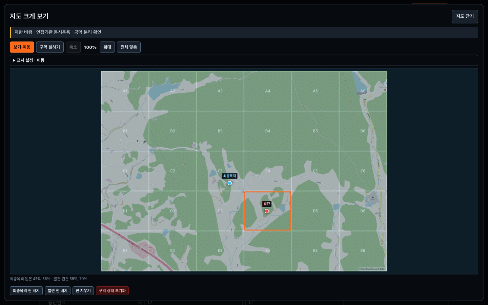
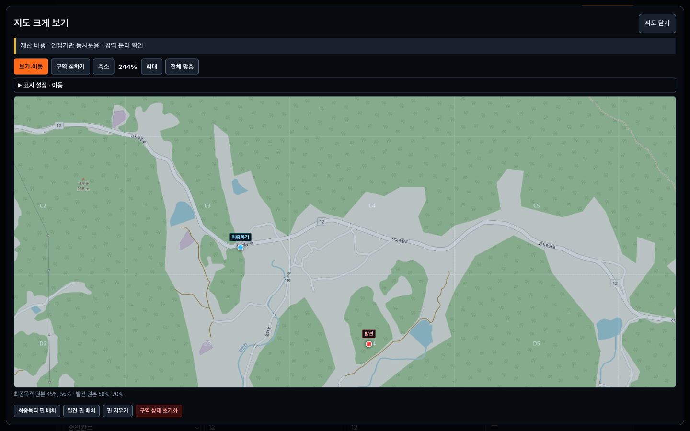

<!-- markdownlint-disable MD013 -->

# STAY UP 사용설명서

처음 사용하는 분을 위한 조작 안내입니다. **상황 준비 → 안전정보 확인 → 기체·지도 조작 → 기록 → 백업** 순서로 따라 하세요. 화면에서 누를 이름은 `이렇게` 표시했습니다.

> STAY UP은 훈련·시연 및 개발 검증용 상황판입니다. 입력한 정보를 모아 보여 주며, 드론을 제어하거나 실제 비행승인·현장 지휘를 대신하지 않습니다.

2026년 10월 18일 개정 · 지역 지도 미리 저장·통신 끊김 후 사용 안내 추가 · 기존 사진 모드와 새 저장 지역 지도 화면 포함

## 화면 예시: 실제 지도와 가상 상황

*PC 기본 표출 화면(1920×1080)입니다. 지도는 완주군의 실제 지형이며, 실종자·기체·인원·핀·활동기록은 모두 가상 시연 데이터입니다. 실제 출동 사례가 아닙니다. 지도 © OpenStreetMap 기여자 · ODbL: [https://www.openstreetmap.org/copyright](https://www.openstreetmap.org/copyright).*

이 화면은 지도 이미지를 넣고 구역을 표시한 예입니다. **실제 지리좌표 보정은 하지 않았습니다.** 화면의 `지도폭 2400m`, 이동 추정반경, 배터리·기상·비행 판정은 샘플 입력과 그 계산 결과이며 실측값·실시간 관제정보가 아닙니다. 지도 이미지의 지명이나 핀 위치만으로 실제 수색 지점을 판단하지 마세요.

기존 사진 모드 예시는 PC의 v1.2.4 촬영본입니다. 촬영 뒤 모바일 지도와 큰 지도의 핀 표시를 보완해 **라벨 글자 최소 13px, 점 최소 14px**를 유지하도록 했습니다. 기본 표시와 큰 글자 표시 모두 같은 하한을 적용합니다. 5장의 저장 지역 지도 예시는 2026-10-18 실제 앱에서 별도로 촬영했으며 각 그림 아래에 자료 기준일을 표시합니다. 모든 화면은 PC 예시이므로 현장·GPS 정확도·물리 터치 장비 인수시험을 마쳤다는 뜻은 아닙니다.

## 1. 시작하기와 두 화면 연결

1. [프로그램 ZIP](https://github.com/MuyeongKim/stayup-dash/archive/refs/heads/main.zip)을 내려받아 압축을 풉니다.
2. 폴더의 `stayup-dash.html`을 **Chrome 또는 Edge**로 엽니다. 처음 열린 화면이 정보를 입력하는 **조작 패널**입니다.
3. 위쪽의 `표출 화면 열기`를 누릅니다. 새 창이 열리지 않으면 브라우저의 팝업 차단 안내를 확인합니다.
4. 새 **표출 화면**을 대형 모니터로 옮깁니다. 입력칸 밖을 클릭한 뒤 `F`를 누르면 전체화면으로 볼 수 있습니다.
5. 표출 창의 `경보음 준비`를 눌러 시험음과 스피커를 확인합니다. 창을 새로 열 때마다 다시 준비하세요.

조작은 한 창에서 합니다. 두 화면은 **같은 PC·같은 브라우저 프로필**에서 열어야 연결됩니다. 다른 PC나 휴대폰과 자동으로 공유하는 기능은 없습니다.

**지역 지도 저장이나 네이버·구글 지도를 사용하려면:** 압축을 푼 폴더 전체를 사용해 HTTPS 주소 또는 로컬 웹 주소로 앱을 엽니다. 파일을 직접 여는 `file://` 방식에서는 사진 지도를 사용합니다. 지역 지도를 저장하고 인터넷 없이 앱을 다시 여는 준비는 HTTPS 또는 `localhost`·`127.0.0.1`에서 합니다. [로컬 실행 방법](./README.md#개발자-메모)과 5장의 순서를 확인하세요. 주소·포트·브라우저 프로필을 옮기면 저장영역이 달라지므로 기존 주소에서 상황 JSON과 지역 지도 파일을 각각 내보내 새 주소에서 불러옵니다.

**처음에는 샘플로 연습하세요.** 별도의 연습용 브라우저 프로필에서 `데이터 → 샘플 상황 넣기`를 누릅니다. 샘플은 현재 내용을 바꿉니다. 기존 기록이 있는 창에서는 먼저 `JSON 내보내기`를 하세요.

**완료 확인:** 조작 패널 위쪽에 `편집권 보유`, `저장·복구 정상`, `표출 화면 연결됨`이 보이고, 표출 창에서 같은 상황명이 보입니다.

## 2. 새 상황 준비하기

이전 상황이 남아 있으면 `데이터 → JSON 내보내기`로 파일을 확보한 뒤 `전체 초기화`를 누르세요. 샘플의 좌표·기체·승인값을 그대로 두고 시작하지 마세요. 초기화는 새 입력을 준비하는 기능이며, 이전 복구본까지 완전히 지우는 기능은 아닙니다.

1. `상황`에서 상황명, 수색 장소, 출동시각, 위도·경도를 입력합니다. 실제 위치와 대조한 뒤 `현장 좌표 확인 완료`를 누릅니다.
2. `실종자`에서 최종목격 시각·장소, 인상착의 등 필요한 정보를 입력합니다. **성명에는 실명 대신 `대상 A` 같은 식별명**을 사용하세요.
3. `인원 → ＋ 인원 추가`로 참여자를 등록합니다. 조종자는 `성명`에 고유 별칭, `역할`에 `조종`, `투입시각`에 실제 시각을 넣고 `종료시각`은 비워 둡니다.
4. `드론 → ＋ 기체 추가`를 누릅니다. `기체 설정 · 조종자 · 센서`를 펼쳐 호기명·기종 등을 입력합니다. `조종(정)`은 인원 명부와 **정확히 같은 별칭**으로 입력합니다. 예: 두 곳 모두 `조종 A`.
5. 기체별 배터리, 담당구역, 고도를 입력하고 `배터리`에서 보유 자원을 확인합니다. 지도는 5장의 순서로 준비합니다.

**완료 확인:** 기체와 인원이 표출 화면에 나타나고, 서로 다른 사람의 별칭이 겹치지 않습니다. 좌표를 바꾸면 기상과 승인도 다시 확인하세요.

## 3. 판정과 기상 확인하기

상단의 판정 안내를 펼치면 **현재 사유와 입력 위치로 이동하는 버튼**이 나옵니다. 표시를 바꾸려고 임의의 값을 넣지 말고, 확인한 사실을 입력하세요.

| 표시 | 의미와 다음 행동 |
| --- | --- |
| 판정 보류 | 좌표·승인·기상·한계값 등 확인이 부족합니다. 안내에 나온 항목을 확인합니다. |
| 비행 불가 | 입력된 조건에서 비행을 제한하는 사유가 있습니다. 현장 책임자에게 알리고 실제 승인·상태를 확인합니다. |
| 제한 비행 | 일몰 임박, 한계에 가까운 바람 등 주의 사유를 확인합니다. |
| 비행 가능 | 입력된 제한사항이 없다는 뜻입니다. 실제 비행 허가를 발급한 것은 아닙니다. |

1. `안전·기상`에서 실제 `비행승인(원스톱)`, 관제권·비행금지구역 해당 여부, 야간 승인 등을 확인합니다.
2. 운용 기준에 맞는 `지속풍 한계 m/s`와 `돌풍 한계 m/s`를 입력합니다. 기본값을 해당 기체의 한계로 간주하지 마세요.
3. 현장에서 확인한 `관측시각`, `풍속 m/s`, `돌풍 m/s`, `현재 강수` 등을 입력하고 `현장 기상 확인 완료`를 누릅니다.

인터넷이 있으면 `기상 자동 갱신` 또는 `지금 갱신`을 사용할 수 있습니다. 자동 조회에는 현장 좌표가 전송되며, 조회값은 현장 관측을 대신하지 않습니다. **자동값도 직접 확인해야 판정에 사용됩니다.** 수동값을 입력하면 자동 덮어쓰기는 중지됩니다.

관측 후 30분이 지났다면 **새로 관측해 값과 관측시각을 갱신한 뒤** 확인하세요. 확인 후 30분이 지났다면 현장 조건을 다시 대조하세요. 오래된 관측시각을 둔 채 확인 버튼만 다시 눌러서는 해소되지 않습니다.

**완료 확인:** 판정 안내에서 남은 사유를 읽고, 두 화면의 판정이 같은지 확인합니다.

## 4. 기체 조작과 활동 기록

**현재 상태를 바꾸는 조작**과 **이력을 남기는 기록**을 구분하면 중복·오기록을 줄일 수 있습니다.

| 할 일 | 사용할 곳 |
| --- | --- |
| 지금 이륙한 기체 반영 | 해당 기체의 `이륙(지금)` — 상태·이륙시각과 이력이 함께 바뀝니다. |
| 지금 착륙한 기체 반영 | 해당 기체의 `착륙` — 배터리교체 상태와 착륙 이력이 반영됩니다. |
| 조종자 교대 종료 | `인원`의 해당 인원에서 `지금 교대 종료`를 누릅니다. 정상 교대는 삭제하지 않습니다. |
| 무전 내용·과거 사건 남기기 | `즉시조작`에서 유형·대상·구역·내용을 넣고 `이력만 기록`을 누릅니다. |

기록의 발생시각은 기본적으로 `지금`입니다. 늦게 입력하는 사건은 `과거 시각 지정`을 선택하세요. **이력만 기록하면 기체·인원·구역의 현재 상태는 바뀌지 않습니다.** 불일치 안내가 나타나면 사실을 확인한 뒤 해당 상태 반영 버튼을 사용합니다.

배터리는 **수동 입력**입니다. 추가 직후의 100%도 실제 확인값이 아닙니다. 실제 잔량을 확인해 값을 고치거나 `배터리 확인 (지금)`을 누르세요. 위험 요약을 누르면 해당 기체로 이동합니다. 오래된 확인시각 안내는 재확인을 위한 표시입니다.

현재 지시는 `상황 → 현재 우선 지시`에 80자 이내로, 긴 내용은 `지휘부 지시 전문`에 적습니다. 지시 전달 이력이 필요하면 별도로 기록합니다. 잘못된 기록은 `전체 기록 조회 · 정정 · 취소`에서 찾으세요. 대상·시각·구역 변경은 원본 취소 후 다시 기록합니다.

**경보:** `유인기 진입`은 경보를 표시하며 실제 드론을 착륙시키지 않습니다. `발견` 기록은 배너와 준비된 경보음을 작동시킵니다.

## 5. 지도와 수색구역 표시하기

`지도·격자 설정`의 `배경 지도`에서 **사진·오프라인 / 저장한 지역 지도 / 네이버지도 / 구글지도** 중 하나를 사용합니다. 인터넷 없이 쓰려면 사진을 준비하거나 이 장의 순서로 필요한 지역 지도를 미리 저장하세요. 그림 아래에 사진 모드와 저장 지역 지도 화면을 구분했습니다. 네이버·구글 실접속 사진은 포함하지 않습니다.

### 먼저 사진을 편하게 보기

*전체 맞춤(100%) 예시입니다. 실제 지도에 가상 최종목격·발견 핀을 배치했습니다. 좌표 미보정 상태이며 핀은 실제 사건 위치가 아닙니다. 지도 © OpenStreetMap 기여자 · ODbL: [https://www.openstreetmap.org/copyright](https://www.openstreetmap.org/copyright).*

1. `수색구역`의 빈 지도에서 `지도·현장 사진 넣기`를 누릅니다. `지도·격자 설정 → 이미지 파일 선택…`이나 이미지 파일 끌어놓기도 사용할 수 있습니다.
2. 처음에는 `보기·이동` 모드입니다. 사진을 살펴보는 동안 구역 상태나 핀이 바뀌지 않습니다.
3. 지도 위의 `확대`·`축소`로 지형을 확인합니다. 확대된 사진은 마우스나 손가락으로 끌어서 이동하고, 전체를 다시 보려면 `전체 맞춤`을 누릅니다. 사진·격자·핀이 함께 움직입니다. 드래그가 어려우면 `표시 설정 · 이동`의 방향 버튼을 사용하세요.
4. 세로 사진이나 작은 지형을 자세히 보려면 `지도 크게 보기`를 사용합니다. 큰 지도에서 입력칸 밖의 `+`·`-`는 지도만 확대·축소합니다. `지도 닫기`로 상황판에 돌아옵니다. `Esc`는 배치 중인 핀·기준점을 먼저 취소하고, 배치 중이 아니면 큰 지도를 닫습니다.
5. `표시 설정 · 이동`에서 `격자`·`담당`·`추정반경`을 켜고 끄거나 `격자 채움 농도` 값을 낮춰 사진을 확인합니다. 표시를 꺼도 기록은 삭제되지 않습니다. 사진 자체가 어두우면 `지도·격자 설정 → 사진 불투명도`도 확인하세요.

큰 지도에도 유인기·미확인 발견·저장 실패 안내가 표시됩니다. `지도 닫고 전체 상태 확인`을 누르면 전체 상황판으로 돌아갑니다. **지도를 닫는 것만으로 경보가 확인 처리되거나 저장 문제가 해결되지는 않습니다.**

**확대·이동·표시 설정은 현재 창의 보기만 바꿉니다.** 조작 창에서 확대해도 대형 표출 창은 같은 배율로 바뀌지 않습니다. 표출 창에서도 필요한 보기로 맞추세요. 보기 설정은 저장·백업하는 현장 기록과 별개입니다.

*보기·이동 모드에서 약 244%로 확대하고 지도를 이동한 PC 예시입니다. 가상 핀은 같은 원본 이미지 지점을 가리키며, 지리좌표 정확도를 검증한 화면은 아닙니다. 지도 © OpenStreetMap 기여자 · ODbL: [https://www.openstreetmap.org/copyright](https://www.openstreetmap.org/copyright).*

### 네이버·구글 지도를 처음 연결하기

1. **인터넷과 웹 주소를 확인합니다.** HTTPS 주소나 로컬 HTTP로 앱을 엽니다. 주소가 `file://`로 시작하면 온라인 지도 대신 웹 실행 안내가 나옵니다.
2. **사용할 지도의 인증키를 준비합니다.** 네이버는 Maps Application에서 `Web Dynamic Map`과 앱을 여는 웹 주소를 등록한 뒤 Client ID를 확인합니다. 구글은 결제 계정이 연결된 프로젝트에서 `Maps JavaScript API`를 켜고 웹사이트·API 제한을 설정한 키를 준비합니다. 기관 담당자가 설정했다면 해당 웹 주소와 키를 전달받으세요. [네이버 등록 안내](https://guide.ncloud-docs.com/docs/maps-app), [구글 설정 안내](https://developers.google.com/maps/documentation/javascript/get-api-key), [구글 키 제한 안내](https://developers.google.com/maps/api-security-best-practices)를 참고하세요.
3. **앱에 키를 저장합니다.** `지도·격자 설정 → 온라인 지도 연결 설정`에서 `NAVER Client ID (ncpKeyId)` 또는 `Google Maps API 키`를 입력하고 `이 브라우저에 키 저장`을 누릅니다. 네이버 Client Secret은 입력하지 않습니다. 키는 현재 주소·브라우저에만 별도 저장하며 상황 JSON이나 복구본에는 넣지 않습니다. 다른 브라우저에서는 다시 입력해야 합니다.
4. **배경과 수색 범위를 고릅니다.** `배경 지도`에서 사업자를, `지도 종류`에서 `일반지도` 또는 `위성지도`를 고릅니다. 사진의 좌표 보정을 마쳤다면 `배경 적용`을 눌러 같은 구역·핀을 온라인 지도에서 봅니다. 보정 전 사진은 먼저 아래의 2점 보정을 진행하세요.
5. **사진 없이 시작할 때만 새 범위를 만듭니다.** `새 수색 범위 만들기`를 펼쳐 `중심 위도`·`중심 경도`·`가로 범위(km)`를 입력하고 `이 좌표로 새 수색 범위 만들기`를 누릅니다. 가로폭은 **0.1~100km**입니다. 확인창을 읽고 진행하면 복구본을 만든 뒤 기존 구역·담당, 기체 담당구역, 핀·사진·보정을 초기화하고 새 범위를 만듭니다. 기존 자료를 이어 쓰려는 경우에는 먼저 JSON을 보관하고 4번의 보정·배경 전환을 사용하세요.
6. **알고 있는 지점을 확인합니다.** 조작 창과 표출 창에서 지형·핀·격자가 같은 위치를 가리키는지 봅니다. 지도 종류를 바꿀 때는 선택한 뒤 `배경 적용`을 누릅니다. 아래의 `구역 칠하기`와 핀 배치는 온라인 지도에서도 같습니다. 웹 실행 환경·키·인터넷이 준비되지 않으면 새 범위를 만들기 전에 안내하고 기존 자료를 유지합니다.

확대·축소하면 지도·칠한 구역·반경이 함께 변하고, 핀은 같은 위치를 가리킵니다. 핀의 점·설명과 격자 글자는 읽기 편한 크기를 유지합니다. 지도를 끌어도 **수색 범위와 칸의 실제 위치는 바뀌지 않습니다.** 위치를 놓쳤다면 `전체 맞춤`을 누르세요. 수색 범위 밖에는 핀이나 구역 상태를 기록할 수 없습니다.

**연결이 끊기거나 인증 오류가 나면:** 현재 범위를 덮는 저장 지도가 선택돼 있으면 그 지도로 전환해 계속 작업합니다. 사용할 저장 지도가 없으면 실패 안내가 나타나고 지도 편집이 잠깁니다. 인터넷·키·등록한 웹 주소를 확인하거나 `배경 지도 → 사진·오프라인 → 배경 적용`으로 돌아갑니다. 배경 전환만으로 구역·핀은 삭제되지 않습니다. 보정된 사진을 보관해 두었다면 다시 보이며, 사진이 없으면 격자만 표시됩니다. 격자만 보이는 상태는 지형을 확인한 상태가 아닙니다.

온라인 지도는 사업자에게 지도 조회 요청을 보내며 이용량·계정에 따라 비용이 발생할 수 있습니다. 네이버·구글 타일을 저장해 인터넷 없이 다시 보거나 JSON에 넣지는 않습니다. 아래 절차로 별도의 지역 지도를 미리 저장하세요. 입력칸이 가려져 있어도 브라우저용 키의 도메인·API 제한은 필요합니다. 공용 PC에서 키만 지우려면 `저장한 키 삭제`를 누릅니다. 현재 안내는 기능 사용 절차이며, 유효한 키로 두 사업자의 실제 지도 연결·과금 설정을 검증한 결과는 아닙니다.

### 출발 전에 필요한 지역 지도를 저장하기

**미리 저장한 지역 지도는 인터넷이 끊겨도 핀과 칠한 구역을 유지하며 사용할 수 있습니다.** Protomaps·OpenStreetMap 기반의 도로·건물·하천 지도이며 일부 지명·도로명을 표시합니다. 네이버·구글과 모양·표시 정보가 다르고 위성사진은 포함하지 않습니다. 네이버·구글 인증키 없이도 준비할 수 있습니다.

*2026-10-18 실제 앱 실행 화면(1440×1000)입니다. Protomaps·OpenStreetMap 지역 지도를 저장하고 네트워크를 차단한 뒤 다시 열어 핀과 C3·D4 완료 구역이 유지되는지 확인했습니다. 원본 지도 자료 기준일은 2026-03-31이며 촬영일과 다릅니다. 핀·구역·상황은 가상 시연이고 실제 출동·물리 GPS 정확도를 검증한 화면이 아닙니다. 지도 © OpenStreetMap 기여자 · Protomaps · [저작권 및 ODbL 안내](https://www.openstreetmap.org/copyright).*

1. **인터넷이 될 때 같은 PC·주소·브라우저에서 준비합니다.** HTTPS 또는 `localhost`·`127.0.0.1`에서 앱을 엽니다. HTML 파일만 옮기지 말고 압축을 푼 폴더 전체를 사용하세요.
2. **이번 수색 범위가 맞는지 확인합니다.** 좌표 보정한 사진이나 기존 온라인 수색 범위를 그대로 씁니다. 아직 범위가 없다면 `배경 지도 → 저장한 지역 지도`를 고르고 `새 수색 범위 만들기`에서 중심 위·경도와 가로폭을 지정합니다. 새 범위 생성은 기존 핀·구역을 초기화하므로 이미 작업 중이면 다시 만들지 마세요.
3. **`지도·격자 설정`을 펼쳐 `오프라인 지역 지도`를 찾습니다.** `저장 세부 수준`은 보통 `기본`(14)으로 시작합니다. 넓은 범위는 `넓은 지역`(12), 더 자세히 볼 범위는 `상세`(15)를 고릅니다. 자세할수록 저장량이 늘어납니다.
4. **`이 수색 범위 미리 저장`을 누릅니다.** 예상량과 한도를 확인하고 다운로드가 끝날 때까지 기다립니다. 취소하거나 오류가 나면 이전 저장 지도와 작업 기록을 유지합니다. 지도 저장과 앱 준비가 모두 끝나야 오프라인 준비 완료입니다. 앱 업데이트 대기 안내가 나오면 관련 창을 모두 닫고 같은 주소를 다시 엽니다.
5. **`저장 지도 사용`을 누릅니다.** 이번 범위의 저장 지도를 선택하고 알려진 지형·핀·격자가 맞는지 두 화면에서 확인합니다. 배경만 바뀌며 칠한 구역·담당·핀·기록은 남습니다.
6. **인터넷을 끈 상태로 확인합니다.** 확대·이동해 보고 같은 주소에서 새로고침해 지도와 기록이 다시 나오는지 확인합니다. 앱 파일만 따로 준비할 때는 `앱 오프라인 준비`를 누릅니다. 로컬 서버를 사용하면 실행 창을 닫지 말고 주소·포트를 유지하세요. 평소 네이버·구글을 쓰려면 점검 후 인터넷을 연결하고 해당 `배경 지도`를 다시 적용합니다. 저장 지도 연결은 남아 있습니다.

**온라인 지도를 보다가 연결이 끊기면:** 현재 수색 범위를 덮는 저장 지도가 선택돼 있을 때 자동으로 저장 지도를 사용합니다. 핀 배치와 구역 칠하기를 계속할 수 있습니다. 인터넷이 돌아와도 배경은 그대로 유지하며, 원하는 때 `온라인 지도 다시 연결`을 눌러 복귀합니다. 처음부터 `저장 지도 사용`을 선택했다면 `배경 지도`에서 네이버·구글을 골라 `배경 적용`으로 돌아갑니다. 준비된 지도가 없거나 읽기 실패 안내가 나오면 새 배치를 멈추고 지도 준비 상태를 확인하세요.

**범위 밖과 확대 한계를 확인하세요.** 저장 범위를 벗어난 지형은 준비되지 않았습니다. 저장한 최고 세부 수준 이상으로 확대하면 이미 받은 지도가 커질 뿐 새 건물·도로 정보가 추가되지 않습니다. 내려받은 날짜와 원본 지도의 갱신 날짜는 다를 수 있으며, 저장 후 현장 변화도 자동 반영되지 않습니다. 지도는 최대 12개, 지도 하나는 4,096개 타일·100MiB까지 저장합니다. 저장량을 초과하면 세부 수준을 낮추고, 사용하지 않는 지도는 백업한 뒤 삭제하세요.

**상황과 지도를 함께 백업하세요.** `JSON 내보내기`는 상황·핀·구역 기록을, `지도 파일 내보내기`는 저장 지역 지도를 보관합니다. 다른 브라우저에서는 JSON을 불러오고 `지도 파일 가져오기`로 지도도 가져온 뒤 `앱 오프라인 준비`를 완료합니다. `선택 지도 삭제`는 지도 파일만 지우며 핀·구역 기록은 남깁니다. 현재 상황에 연결된 지도는 삭제할 수 없으므로 다른 저장 지도를 연결하거나 새 상황으로 전환한 뒤 삭제하세요. 브라우저 데이터 삭제·저장공간 회수에 대비해 두 파일을 따로 보관하세요.

지역 지도 파일은 이름이 `.stayup-map.json`으로 끝납니다. 이 파일은 일반 `JSON 불러오기`가 아닌 `지도 파일 가져오기`로 엽니다.

**완료 확인:** 인터넷을 끄고 같은 주소를 새로고침한 뒤에도 지도·핀·칠한 구역을 볼 수 있으며, 저장 범위 안에서 작업할 수 있습니다.

### 구역을 칠하고 핀 놓기

*큰 지도에서 C3·C4·D4를 완료·담당 드론으로 칠한 예시입니다. 구역과 핀·기록은 가상 데이터이며 실제 수색 실적이 아닙니다. 좌표 보정과 실거리 검증은 하지 않았습니다. 지도 © OpenStreetMap 기여자 · ODbL: [https://www.openstreetmap.org/copyright](https://www.openstreetmap.org/copyright).*

1. 필요한 격자 크기는 `지도·격자 설정`에서 `행 수`·`열 수`를 입력하고 `격자 크기 적용`으로 확정합니다. 확인창의 초기화 범위를 읽고 적용하세요.
2. `구역 칠하기`를 누른 뒤 **상태**와 **담당**을 고릅니다. 휴대 화면에서는 `칠하기 설정`을 펼쳐 선택하고 다시 접으면 지도를 넓게 볼 수 있습니다. 접힌 제목에도 현재 선택값이 표시됩니다. 바꾸지 않을 항목은 `그대로`를 선택합니다. 칸을 누르거나 마우스·손가락으로 여러 칸을 쓸어 반영합니다. 터치 칠하기에서는 칸을 누르기 편하게 자동 확대될 수 있습니다. 작업이 끝나면 `보기·이동`으로 돌아갑니다.
3. 잘못 칠한 직전 작업은 `직전 쓸기 취소`로 한 번 되돌릴 수 있습니다.
4. `최종목격 핀 배치` 또는 `발견 핀 배치`를 누르고 **사진 내부 또는 지역·온라인 지도의 수색 범위 내부**를 선택합니다. 사진 바깥의 빈 여백이나 수색 범위 밖에는 핀이 놓이지 않습니다. 중단하려면 `배치 취소` 또는 `Esc`를 누릅니다.

**휴대 화면에서 이동할 때:** 페이지를 스크롤하려면 `보기·이동`과 `전체 맞춤`을 사용합니다. `구역 칠하기`에서의 손가락 쓸기는 구역을 바꾸는 동작입니다. 두 손가락이 닿거나 브라우저가 작업을 취소하면 진행 중인 칠하기는 저장되지 않습니다.

키보드는 칸에 포커스를 두고 방향키로 이동합니다. `구역 칠하기`에서 `Enter`·`Space`를 누르면 칸을 칠하고, 핀 배치 중에는 **선택한 칸의 중심에 핀을 놓습니다.** `보기·이동`에서는 칸을 눌러도 기록이 바뀌지 않습니다. 정확한 핀 위치는 마우스·터치로 지정하세요. 발견 핀 배치와 `발견` 이벤트 기록은 별개의 조작입니다.

### 좌표와 기존 자료 확인하기

사진에 좌표를 연결하려면 `좌표 보정`에서 대각선으로 떨어진 기준점 두 곳을 찍고 위·경도를 입력한 뒤 `2점 보정 적용`을 누릅니다. 보정 후에도 사진을 확대·이동할 수 있습니다. **보정의 기준은 원본 사진 위치**이며, 화면 배율을 바꿔도 같은 지점의 좌표는 유지됩니다. 보정 전의 `A1`, `C3`는 구역 이름입니다. 온라인용 `새 수색 범위 만들기`를 완료했다면 입력한 중심·폭으로 좌표가 설정되어 사진의 2점 보정을 다시 할 필요가 없습니다. [좌표 보정 상세 안내](./README.md#좌표-보정)를 함께 확인하세요.

**구버전 자료의 재확인 안내가 나오면:** 이전 확대·이동 또는 좌표 보정 이력이 있는 자료를 다시 확인하는 안내입니다. 이전 버전의 확대·이동값은 해제하고 전체 사진을 기준으로 표시합니다. 이미 잘못 놓인 핀이나 잘못 입력된 좌표를 자동으로 고쳐 주지는 않습니다. 먼저 JSON으로 원본을 보관한 뒤, 알려진 지점과 핀·격자·보정값을 대조하세요. 새 칠하기·핀 배치는 확인 전까지 잠깁니다. 보정 오류는 다시 보정하고 `지도·표식 확인 완료`의 확인창을 읽은 뒤 진행하세요. 이때 확인 전 복구본을 저장합니다. 기존 핀이 잘못됐다면 확인을 마친 뒤 핀을 다시 지정하세요.

**지도 교체 전에는 백업하세요.** 다른 이미지로 바꾸면 구역 상태·담당, 기체 담당구역, 핀과 좌표 보정이 초기화됩니다. 격자 크기만 바꾸면 구역·기체 담당구역은 초기화되지만 지도·핀·보정은 유지됩니다. 넣기 전 원본 이미지와 좌표 파일도 별도로 보관하세요. JSON에는 앱이 축소해 저장한 이미지가 들어갑니다.

**완료 확인:** 같은 지형을 확대·축소해도 핀·격자가 따라가고, 양쪽 화면에서 같은 구역과 핀이 같은 지점을 가리킵니다.

## 6. AI 사진 후보 파일 연계

1. AI-page에서 사진을 분석하고 후보를 확인한 뒤 **상황판으로 내보내기**로 `stayup-ai-candidates.json`을 저장합니다. 다른 PC에는 이 파일을 전달합니다.
2. 연계 버전으로 조작·표출 창을 모두 다시 연 뒤, 조작 창의 **AI 후보 → AI 후보 불러오기**를 누릅니다. 후보 JSON 한 개를 창에 끌어다 놓아도 됩니다. 기존 **JSON 불러오기**는 상황 전체 복원이므로 용도가 다릅니다.
3. 확인창의 **현재 상황명·원본 분석 상태·성공/실패 수·신규·갱신 수**를 확인하고 반영합니다. 기존 상황·기체·지도·수색 상태·대응 기록은 유지합니다. 부분 완료·실패·취소 작업은 별도로 표시하며 원본 처리 통계가 없는 구형 보관본은 미상으로 표시합니다. 같은 파일은 중복되지 않으며, 과거 리비전·같은 리비전의 내용 충돌은 거부합니다.
4. **사진 확인**으로 축소 이미지를 보고 **대응 상태·메모 → 대응 저장**을 사용합니다. 탐지 프로그램에서 판정을 바꾸고 다시 보내도 이 대응 기록은 유지됩니다. 원본에서 빠진 후보는 해당 필터로 확인합니다.
5. GPS가 있는 사진은 보정된 지도 범위 안에서 **AI N** 촬영 지점으로 묶입니다. GPS 없음·미보정·범위 밖은 목록에 이유를 표시합니다. GPS는 사람의 정확한 좌표가 아닙니다. 발견·수색 완료는 자동 변경하지 않습니다.

후보 이미지도 전체 JSON 백업·복구에 포함됩니다. 이미지 읽기/저장 실패 시 안내를 확인하고 원본 후보 파일을 다시 불러오세요. 파일은 16 MiB, 현재 상황의 후보는 5,000건까지 지원하며 브라우저 저장공간에 따라 더 작은 묶음도 실패할 수 있습니다. 저장 실패 시 기존 기록을 유지합니다. 다른 PC 자동 전송·실시간 영상 연계·위치 OCR은 후속입니다.

### 같은 PC에서 폴더를 자동으로 읽기

1. AI-page **작업 결과 → 상황판 자동 저장 폴더 연결**에서 이번 수색용 후보 전용 폴더를 선택합니다. 사진 분석 종료·사진 기록 열기·판정 저장 때 작업별 `stayup-ai-candidates-<작업 UUID>.json`을 자동 저장합니다.
2. 상황판 **AI 후보 → 자동 읽기 폴더 연결**에서 같은 폴더를 고르고 읽기 권한을 허용합니다. 현재 상황명과 폴더를 확인하고 연결합니다. 폴더의 기존 후보 파일도 현재 상황에 반영됩니다.
3. 폴더명·마지막 확인시각·반영/오류 수를 확인합니다. 약 2초 간격으로 읽고 기존 대응 상태·메모를 보존합니다. 파일을 삭제해도 상황판 기록은 지우지 않습니다.
4. 사용 종료 시 양쪽 **연결 해제**를 누릅니다. 새로고침·상황 교체/복구·수동 후보/지도 불러오기·편집권/권한 상실 후에는 다시 연결합니다. 연결 경로·권한 핸들은 백업에 넣지 않습니다.

Chrome·Edge의 파일 직접 실행 또는 HTTPS·localhost에서 사용합니다. 백그라운드·절전에서는 읽기가 늦어질 수 있습니다. 한 폴더 바로 아래 후보 파일 500개·합계 64 MiB·개별 16 MiB까지 읽으며, 전체 후보 5,000건·작업 500개 한도도 적용합니다. 오류 파일은 고친 뒤 다시 연결하거나 **AI 후보 불러오기**로 전달합니다. 파일이 많으면 이번 수색의 파일만 전용 폴더에 모으세요. 상황판 완전삭제 후에도 연결 폴더의 후보 JSON은 남으므로 별도로 정리합니다.

## 7. 표출 화면과 작은 화면 사용하기

`데이터 → 표출 구성`에서 화면 목적에 맞게 선택합니다.

| 구성 | 표시하는 정보 |
| --- | --- |
| 기본 · 전체 정보 | 상황, 실종자, 지도, 기체, 인원, 안전·기록 등 상세를 함께 봅니다. |
| 원거리 · 핵심 정보 | 비행 판정, 위험 기체, 지도, 현재 우선 지시를 크게 봅니다. 상세정보는 조작 패널에 남습니다. |

1. 대형 화면에서는 `원거리 · 핵심 정보`를 선택하고 `상황 → 현재 우선 지시`를 입력합니다.
2. `표출 화면 배율` 또는 `+`·`-`로 크기를 맞춥니다. 확대 후에는 경보와 위험 요약, 지도, 지시가 실제 시청 위치에서 읽히는지 확인합니다.
3. 주변이 어두우면 `야간 밝기 저감`을 조절합니다. 글자가 너무 어두워지지 않도록 확인하세요.

정보가 많은 카드와 위험 요약은 내부를 스크롤해야 할 수 있습니다. 요약만 읽고 아래 기체를 놓치지 않도록, 필요한 기체의 카드를 함께 확인하세요.

좁은 화면에서는 하단의 `조작 / 지도 / 기체 / 더보기`를 사용합니다. `더보기`에는 안전·기상, 인원, 상황·지시, 화면·데이터 등이 있습니다. 상단의 짧은 판정 상태줄을 누르면 확인할 사유로 이동합니다. 휴대폰에서 별도로 연 내용은 노트북 상황과 자동 동기화되지 않습니다.

**모바일 핀 표시:** 지도와 큰 지도에서 핀 라벨 글자는 최소 13px, 점은 최소 14px로 표시합니다. 화면 폭이 좁아지거나 큰 글자 표시를 선택해도 이 하한을 유지합니다. 핀의 테두리와 라벨 여백에도 최소 크기를 적용했습니다. 이는 표시 크기 보완이며, 핀의 저장 위치나 지도 좌표를 바꾸는 기능은 아닙니다.

사진을 촬영한 v1.2.4에서는 390px 화면의 핀 라벨 약 2.93px, 점 약 3.41px 문제가 있었습니다. 이 수치는 **개선 전 검토 기록**입니다. 현재 보완 이후에도 실제 장비의 화면 배율·시청거리·물리 터치 환경은 별도로 확인하고, 필요한 위치는 PC의 큰 지도와 대조하세요.

**완료 확인:** 기본·원거리 전환 후에도 기체·인원 원본 정보는 남고, 현재 우선 지시가 표출됩니다.

## 8. 백업·복구와 사용 종료

브라우저에 저장됐다는 표시만으로 외부 백업까지 완료된 것은 아닙니다. 파일 이동·브라우저 변경·업데이트·초기화 전에는 **JSON 파일을 따로 보관**하세요.

파일 종류에 맞는 버튼으로 불러오세요.

| 파일 | 불러오는 곳 | 포함하는 내용 |
| --- | --- | --- |
| 상황 JSON 백업 | `데이터 → JSON 불러오기` | 상황·핀·구역·기록·저장된 사진·AI 후보와 축소 이미지 |
| `.stayup-map.json` 지역 지도 | `오프라인 지역 지도 → 지도 파일 가져오기` | 저장 지역의 지도 데이터 |
| `stayup-ai-candidates.json` | `AI 후보 → AI 후보 불러오기` | AI-page에서 전달한 사진 후보 |

1. `데이터 → 자동 보관`을 켭니다. `보관 파일 지정…`이 보이면 이번 상황용 파일을 지정합니다. 이후 변경은 그 파일에 덮어씁니다. 파일 지정이 불가능하거나 지정하지 않으면 변경이 있을 때 약 10분 간격으로 JSON을 내려받습니다. 첫 다운로드는 더 일찍 시작될 수 있습니다.
2. 상단의 `보관 방금` 또는 `보관 N분 전`을 확인합니다. 새로고침하거나 샘플·초기화·불러오기·복구로 전환했다면 파일을 다시 지정하세요.
3. 마무리할 때 `JSON 내보내기`를 누릅니다. 다운로드 목록에서 생성된 파일을 확인해 승인된 보관 위치로 옮깁니다. 저장된 사진·좌표 범위·핀·구역·기록도 포함됩니다. **저장 지역 지도의 데이터 본체, 네이버·구글 타일과 인증키는 포함하지 않습니다.** 지역 지도는 5장의 `지도 파일 내보내기`로 별도 보관합니다. 새 브라우저에서는 지역 지도를 가져오고 온라인 인증키도 별도로 설정해야 합니다. 문서에 붙일 글이 필요하면 `활동일지 복사`를 사용합니다.

잘못 바꿨다면 먼저 현재 내용도 내보내세요. 저장된 파일은 `JSON 불러오기`로, 같은 브라우저의 복구본은 시각·사유를 고른 뒤 `선택한 복구본 적용`으로 되돌립니다. 복구 후에는 상황·지도·최근 기록을 확인합니다. 브라우저 데이터를 지우면 내부 복구본도 사라집니다.

종료 후 내부 정보를 지우려면 `출동 종료 · 개인정보 완전 삭제`를 누릅니다. 필요한 지역 지도는 먼저 별도 파일로 내보내세요. 다운로드가 시작되면 **실제 파일 생성과 보관 위치를 먼저 확인**한 뒤, 안내에 따라 `완전삭제`를 입력합니다. 저장한 사진·지역 지도와 온라인 지도 키도 제거됩니다. 삭제가 끝나면 관련 창을 모두 닫습니다.

**완전 삭제는 되돌릴 수 없습니다.** 다운로드 파일·USB 사본·스크린샷·클립보드는 별도로 정리해야 합니다. JSON은 암호화 파일이 아니므로 접근 가능한 사람과 보관 위치를 관리하세요.

## 9. 막혔을 때와 단축키

| 증상 | 먼저 할 일 |
| --- | --- |
| 읽기 전용으로 열림 | 편집 중인 기존 조작 창을 닫습니다. 잠금 해제까지 최대 15초 기다린 뒤 `편집권 가져오기`를 누릅니다. |
| 표출 화면 미연결 | 같은 PC·브라우저 프로필에서 `표출 화면 열기`로 다시 엽니다. |
| 저장 실패·자동 보관 실패 | 실패 안내를 확인합니다. 가능하면 즉시 JSON을 내보내 실제 파일 생성을 확인하고 저장공간을 점검합니다. 백업 전에는 브라우저 데이터를 지우지 마세요. |
| 기체 이륙 후 비행 불가 | 조종자 별칭, 인원의 `조종` 역할·투입시각·종료시각을 확인합니다. 다른 사유도 판정 안내에서 읽습니다. |
| 숫자가 저장되지 않음 | 입력칸 아래 허용 범위 안내를 읽고 값을 수정합니다. |
| 지도를 눌러도 구역이 안 바뀜 | 기본 `보기·이동`에서는 기록을 바꾸지 않습니다. `구역 칠하기`를 선택하고 상태·담당을 고릅니다. |
| 지형이 잘 안 보이거나 위치를 놓침 | `전체 맞춤`으로 돌아온 뒤 `지도 크게 보기`와 `격자 채움 농도`를 조절합니다. |
| 네이버·구글 지도가 안 나옴 | 웹 주소·인터넷·키·API 설정을 확인합니다. 범위가 맞는 저장 지도 또는 보정된 사진으로 전환해 사용합니다. 새 브라우저에서는 키를 다시 저장합니다. |
| 지역 지도 저장을 시작할 수 없음 | HTTPS·localhost 실행과 수색 좌표 범위를 확인합니다. 저장 예상량이 한도를 넘으면 세부 수준을 낮춥니다. 작업 중 수색 범위를 새로 만들면 핀·구역이 초기화되므로 먼저 JSON을 보관하세요. |
| 저장 지도 표시·WebGL 오류 | 대상 PC의 Chrome·Edge와 그래픽 가속 지원을 확인합니다. 저장이 완료돼도 해당 장비에서 지도를 표시할 수 있는지 출발 전에 확인해야 합니다. |
| 지도 저장 중 오류·취소 | 준비 완료로 간주하지 마세요. 인터넷·남은 공간을 확인하고 다시 저장합니다. 이전 저장 지도와 핀·구역 기록은 유지됩니다. |
| 인터넷을 끄고 새로고침하면 앱이 안 열림 | 연결을 복구하고 같은 주소에서 `앱 오프라인 준비` 완료를 확인합니다. 업데이트 대기 안내가 있으면 모든 관련 창을 닫고 다시 엽니다. 로컬 서버 주소·포트도 확인합니다. |
| 다른 브라우저에서 저장 지도가 안 나옴 | 상황 JSON만으로 지역 지도를 복원할 수 없습니다. 기존 브라우저의 `지도 파일 내보내기` 후 새 브라우저에서 `지도 파일 가져오기`를 진행합니다. |
| 인터넷이 돌아왔는데 저장 지도가 계속 보임 | 작업 중 배경이 바뀌지 않도록 유지하는 동작입니다. 원하는 때 `온라인 지도 다시 연결`을 누릅니다. |
| 구버전 지도 재확인 안내 | JSON을 보관하고 핀·격자·보정을 대조합니다. 필요한 보정 후 `지도·표식 확인 완료`를 진행합니다. 잘못된 기존 핀은 확인 후 다시 지정하세요. |
| 기상 자동 조회 실패 | 인터넷과 좌표를 확인합니다. 현장 관측값을 수동 입력한 뒤 `현장 기상 확인 완료`를 누릅니다. |
| 경보음이 안 남 | 표출 창의 `경보음 준비`, PC 음소거와 출력 장치를 확인합니다. |
| 새로 열었더니 내용이 없음 | 파일 위치·브라우저·프로필이 달라졌는지 확인합니다. 새 샘플을 넣기 전에 기존 환경 또는 JSON 백업을 찾습니다. |

| 키 | 동작 |
| --- | --- |
| `F` | 전체화면 켜기·끄기 |
| `+` / `-` | 큰 지도에서는 지도 확대·축소, 그 밖에서는 표출 배율 조절 |
| `Ctrl+E` / Mac `⌘+E` | 표출 화면 안의 조작 패널 열기·닫기. 큰 지도가 열려 있으면 먼저 닫음 |
| `Esc` | 핀·기준점 배치를 먼저 취소. 배치 중이 아니면 큰 지도 또는 열린 조작 패널 닫기 |
| 방향키 → `Enter` / `Space` | 지도 칸 이동 후 선택한 칠하기·핀 배치 동작 실행. `보기·이동`에서는 기록 변경 없음 |
| `Ctrl+Z` / Mac `⌘+Z` | 직전 지도 쓸기 취소 |

전체화면·배율·쓸기 취소 단축키는 입력칸 밖에서 사용하세요. 입력 중에는 일반 편집키로 동작할 수 있습니다. 상세 기능·제한은 [README](./README.md)를 확인하세요.
